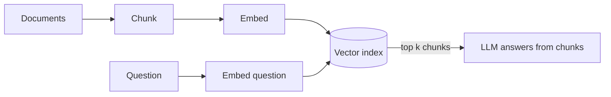
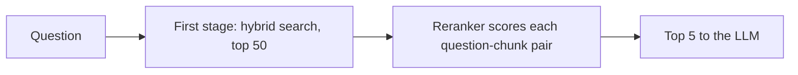
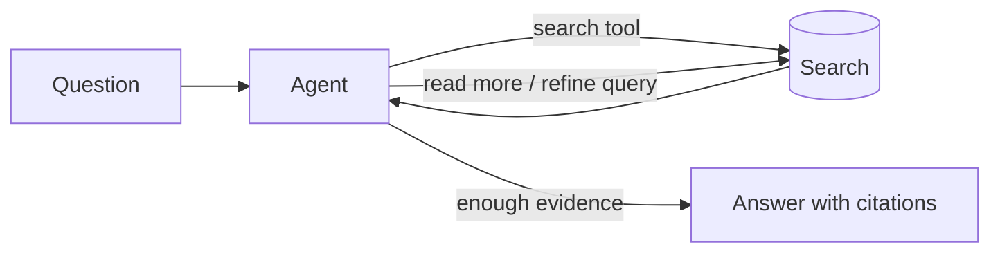

# Advanced RAG Patterns

**In one line:** When basic "embed, retrieve top 5, answer" stops being good enough, these patterns (better chunking, hybrid search, reranking, query rewriting, contextual retrieval, GraphRAG and agentic retrieval) fix specific, diagnosable failures; measure first, then add only the one that fixes your failure.
**Last reviewed:** 2026-10-21

---

## The short version

- Most RAG problems are **retrieval** problems, not generation problems. If the right passage is not in the context, no model can answer correctly. Measure retrieval separately from answer quality.
- The highest-value upgrades, roughly in order: **fix chunking**, add **hybrid search** (keywords plus vectors), add a **reranker**, add **contextual chunk headers**, then **query rewriting**.
- Heavier patterns (**GraphRAG**, **agentic multi-hop retrieval**) solve specific problems: questions about a whole corpus, or questions that need several lookups. They cost more and are harder to evaluate.
- Long context windows do not make RAG obsolete. They change the trade-off: for a small, stable corpus, put it all in the prompt with caching; for a large or changing corpus, retrieve.
- Every pattern here should earn its place on a retrieval eval (recall@k, MRR) and an answer eval (faithfulness, correctness).

## Start with the baseline and its failure modes

If this pipeline is new to you, read [RAG explained](../../learn/concepts/rag-explained.md), [embeddings and vector search](../../learn/concepts/embeddings-and-vector-search.md) and the original [RAG paper](../../papers/techniques/13-rag/summary.md), then build it with [build a RAG pipeline](../projects/build-rag-pipeline.md).

Diagnose before you change anything. Take 30 to 50 real questions, note which chunk should answer each, and check:

| Symptom | Likely cause | Pattern to try |
|---|---|---|
| Right document, wrong chunk retrieved | Chunks split the answer, or are too big | Chunking strategy, parent-child |
| Exact names, codes or IDs not found | Embeddings blur exact tokens | Hybrid search |
| Relevant chunk is at rank 12, not top 5 | First-stage ranking is coarse | Reranking |
| Chunk retrieved but lacks context ("it increased 4%") | Chunk lost its document context | Contextual retrieval |
| Vague or conversational questions fail | Query does not look like the documents | Query rewriting, HyDE |
| "What are the main themes across all reports?" fails | Needs the whole corpus, not top-k | GraphRAG, summaries |
| Answer needs facts from two places | One retrieval cannot get both | Multi-hop / agentic retrieval |
| Retrieved text is right, answer is still wrong | Generation problem | Prompting, citations, stronger model |

## Pattern: chunking that respects structure

Fixed-size chunks (say 500 tokens with overlap) are a fine start. Improvements:

- **Split on structure**: headings, sections, list items, table rows. Keep a table with its header.
- **Parent-child (small-to-big)**: retrieve small, precise chunks, then pass the larger parent section to the model.
- **Keep metadata**: title, section path, date, author, access level. You will filter on it later.

## Pattern: hybrid search

Run a keyword search (BM25) and a vector search in parallel, then merge the result lists, commonly with **reciprocal rank fusion** (each result scores the sum of 1 / (k + rank) across lists). Keyword search catches exact strings like "error E-4012" or a product SKU that embeddings smear; vectors catch paraphrases. Most vector databases support hybrid search natively as of 2026-10; see [vector database](../../tools/decisions/vector-database.md). The retrieval research behind both halves is in [dense retrieval, ColBERT and Sentence-BERT](../../papers/techniques/87-dense-retrieval/summary.md).

## Pattern: reranking

First-stage retrieval compares the question and each chunk independently, which is fast but coarse. A **cross-encoder reranker** reads the question and chunk together and scores relevance much more precisely. Retrieve wide (top 30 to 100), rerank, keep the top few. Options include hosted rerank APIs and open-source cross-encoder models. You can also use a small LLM as a reranker, at higher cost per query.

This is usually the single biggest precision gain after hybrid search, for a few hundred milliseconds of added latency.

## Pattern: contextual retrieval

A chunk like "Revenue grew 4% over the previous quarter" is useless without knowing which company and which quarter. Before indexing, prepend a short, generated context line to each chunk ("This chunk is from Acme Corp's Q2 2025 10-Q, section on revenue."), then embed and keyword-index the combined text. Anthropic published this technique in 2024 as "contextual retrieval" and reported that combining contextual embeddings with contextual BM25 reduced failed retrievals by 49%, and by 67% with reranking added, on its test sets.

It costs one cheap LLM call per chunk at index time, which prompt caching on the full document makes much cheaper.

## Pattern: query transformation

- **Rewrite**: turn a conversational follow-up ("what about for contractors?") into a standalone query using the chat history.
- **Decompose**: split "compare our EU and US leave policies" into two retrievals.
- **Multi-query**: generate 3 to 5 phrasings, retrieve for each, merge.
- **HyDE** (hypothetical document embeddings): have the model write a plausible answer, embed that, and search with it. It works because the fake answer looks more like the documents than the question does.

Each adds an LLM call before retrieval, so latency goes up. Use a small fast model.

## Pattern: GraphRAG and corpus-level questions

Top-k retrieval cannot answer "what are the recurring themes across 2,000 customer interviews?" because no single chunk contains the answer. [GraphRAG](../../papers/techniques/60-graph-rag/summary.md) (Microsoft, 2024) extracts entities and relationships into a knowledge graph, clusters it into communities, and pre-writes summaries of each community. Global questions are answered from the summaries; local questions can walk the graph.

| | Vector RAG | GraphRAG |
|---|---|---|
| Good at | Specific facts in specific passages | Themes, relationships, "connect the dots" questions |
| Index cost | Embeddings only (cheap) | Many LLM calls to extract and summarise (expensive) |
| Freshness | Easy incremental updates | Re-summarisation needed as data changes |
| Evaluation | Well understood | Harder; answers are synthetic |

A cheaper middle ground: pre-compute summaries per document and per folder, and retrieve over those as well as the chunks.

## Pattern: agentic and multi-hop retrieval

Give the model search as a tool and let it decide what to look up next, as in [agent architectures](agent-architectures.md). It handles questions that need several lookups ("which of our suppliers in the flagged region had late deliveries last quarter?") and can mix sources (vector search, SQL, web). The cost is variable latency and spend, so put a step budget on it.

## Pattern: long context instead of retrieval

Current frontier models accept very long inputs; Anthropic's current models take up to 1M tokens as of 2026-10. For a small, stable corpus (a product manual, a policy set), putting it all in a cached prompt can beat a retrieval pipeline on both quality and engineering effort. But long-context accuracy degrades in ways headline numbers hide; see [RULER](../../papers/techniques/132-ruler/summary.md) and [context windows](../../explainers/concepts/context-windows.md). Cost scales with every token on every request unless cached. Measure both approaches on your questions.

## Generation-side patterns

- **Cite or abstain**: require a citation per claim, and an explicit "not in the sources" answer. Check citations programmatically.
- **Grounding check**: a second, cheap call verifies each claim against the retrieved text.
- **Order matters**: put the most relevant chunks first or last; models attend less to the middle of long contexts.

## Evaluating RAG

Score retrieval and generation separately.

| Layer | Metric | How |
|---|---|---|
| Retrieval | Recall@k | Is the known-relevant chunk in the top k? |
| Retrieval | MRR | How high is the first relevant chunk? |
| Generation | Faithfulness | Is every claim supported by retrieved text? (LLM judge plus spot checks) |
| Generation | Answer correctness | Matches a reference answer? |
| End to end | Abstention accuracy | Says "I don't know" when it should |

Open-source libraries such as Ragas and DeepEval implement these. LLM-as-judge scoring is useful but biased; see [LLM-as-a-judge](../../papers/techniques/85-llm-as-judge/summary.md) and [evals for LLMs](../../learn/concepts/evals-for-llms.md).

## Common mistakes

- **Tuning the prompt when retrieval is the problem.** Check recall first.
- **Adding five patterns at once.** You will not know which one helped, and latency will balloon.
- **No access control in retrieval.** Filter by the user's permissions at query time, or the bot will happily quote documents the user should not see.
- **Stale indexes.** Plan for updates and deletes from day one.
- **Evaluating on questions you wrote while looking at the documents.** Real user questions are vaguer. Use logs.

## Next steps

- Build it: [build a RAG pipeline](../projects/build-rag-pipeline.md), [set up an eval harness](../projects/set-up-eval-harness.md)
- Choose the store: [vector database](../../tools/decisions/vector-database.md)
- Decide whether to retrieve at all: [fine-tuning vs RAG](../../learn/concepts/fine-tuning-vs-rag.md)
- Architecture context: [LLM app architecture](llm-app-architecture.md)

## Sources

- Lewis et al., "Retrieval-Augmented Generation for Knowledge-Intensive NLP Tasks" (2020): https://arxiv.org/abs/2005.11401
- Anthropic, "Introducing Contextual Retrieval" (Sept 2024; 49% and 67% figures): https://www.anthropic.com/news/contextual-retrieval
- Edge et al., "From Local to Global: A Graph RAG Approach to Query-Focused Summarization" (2024): https://arxiv.org/abs/2404.16130
- Gao et al., "Precise Zero-Shot Dense Retrieval without Relevance Labels" (HyDE, 2022): https://arxiv.org/abs/2212.10496
- Cormack et al., "Reciprocal Rank Fusion outperforms Condorcet and individual Rank Learning Methods" (2009): https://plg.uwaterloo.ca/~gvcormac/cormacksigir09-rrf.pdf
- Liu et al., "Lost in the Middle: How Language Models Use Long Contexts" (2023): https://arxiv.org/abs/2307.03172
- Anthropic, Models overview (1M context; as of 2026-10): https://platform.claude.com/docs/en/about-claude/models/overview
