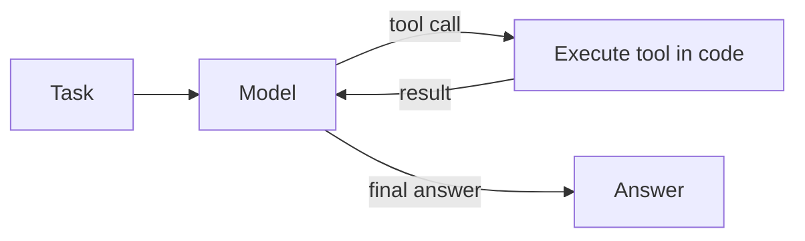
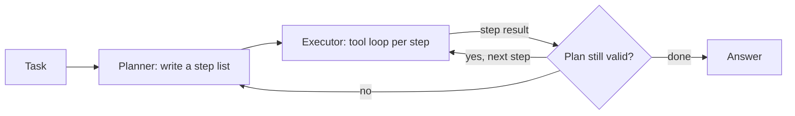
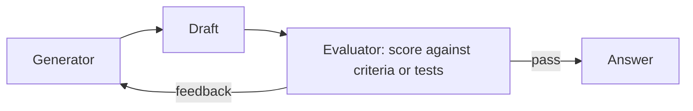
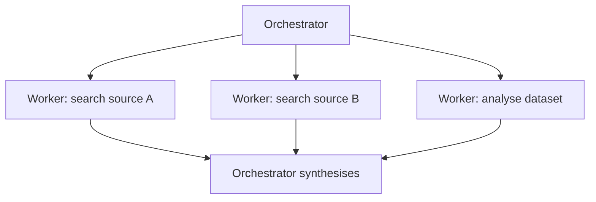
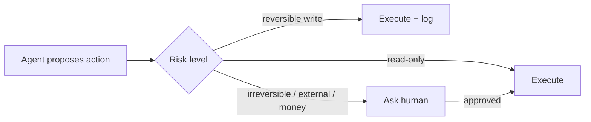

# Agent Architectures

**In one line:** An agent is an LLM calling tools in a loop until a task is done; this page shows the six common shapes (from a single tool loop to multi-agent orchestration), when each one earns its extra cost, and where to put the controls that keep it safe.
**Last reviewed:** 2026-10-21

---

## The short version

- **Workflow vs agent.** In a workflow, your code decides the steps. In an agent, the model decides the next step at run time. Use a workflow whenever you can write the steps down.
- The base pattern is the **tool loop** (ReAct): think, call a tool, read the result, repeat, answer. Almost every agent framework is this loop plus extras.
- Add structure only when the base loop fails: **planner-executor** for long tasks, **evaluator-optimizer** for quality, **orchestrator-workers** for parallel sub-tasks, **multi-agent** for genuinely separate roles or context limits.
- Agents fail in specific ways: loops that never end, compounding errors, runaway cost, context overflow, and being hijacked by text they read. Each has a known control.
- Put **hard limits in code**: step and token budgets, tool allowlists, argument validation, and human approval for irreversible actions.

## Workflow or agent?

| Question | If yes | If no |
|---|---|---|
| Can you list the steps in advance? | Workflow | Agent may be justified |
| Is a wrong step expensive or irreversible? | Workflow, or agent with approval gates | Agent is fine |
| Does the task need many tool calls whose order depends on results? | Agent | Workflow |
| Do you need predictable latency and cost? | Workflow | Agent acceptable |

Anthropic's [Building Effective Agents](../../papers/essays/115-building-effective-agents/summary.md) makes this distinction and recommends starting simple. For the concepts behind this page, read [agents explained](../../learn/concepts/agents-explained.md) and [agentic loops](../../learn/concepts/agentic-loops.md).

## Pattern 1: the tool loop (ReAct)



The model receives the task and a list of tools. Each turn it either calls a tool or answers. Your code executes tool calls and feeds results back. This comes from [ReAct](../../papers/techniques/21-react/summary.md) (reasoning plus acting) and [Toolformer](../../papers/techniques/24-toolformer/summary.md) (models learning when to call tools). Modern models are trained heavily for this loop, and reasoning models interleave thinking between tool calls; see [reasoning models](../../explainers/concepts/reasoning-models.md).

Minimal loop in Python with the Anthropic SDK:

```python
import anthropic
client = anthropic.Anthropic()

def run_agent(task, tools, handlers, max_steps=15):
    messages = [{"role": "user", "content": task}]
    for _ in range(max_steps):
        resp = client.messages.create(model="claude-opus-5-5", max_tokens=8000,
                                      tools=tools, messages=messages)
        messages.append({"role": "assistant", "content": resp.content})
        if resp.stop_reason != "tool_use":
            return "".join(b.text for b in resp.content if b.type == "text")
        results = []
        for block in resp.content:
            if block.type == "tool_use":
                try:
                    out = handlers[block.name](**block.input)   # your code runs the tool
                    results.append({"type": "tool_result", "tool_use_id": block.id, "content": str(out)})
                except Exception as e:
                    results.append({"type": "tool_result", "tool_use_id": block.id,
                                    "content": f"Error: {e}", "is_error": True})
        messages.append({"role": "user", "content": results})   # all results in one message
    return "Stopped: step limit reached"
```

Note the controls already present: a step limit, errors returned to the model instead of crashing, and your code (not the model) executing tools. The SDKs also offer a tool runner helper that writes this loop for you. For a full build, see [build a Claude agent with MCP](../projects/build-claude-agent-with-mcp.md).

**Use it for:** most agent tasks. Start here.

## Pattern 2: planner-executor



A first call writes an explicit plan; an executor works through it; the plan is revised when results contradict it. The plan doubles as a progress record and a place for a human to approve the approach before any action.

**Use it for:** long tasks (many steps, many minutes), tasks where you want a human to approve the approach first. **Cost:** one extra call per (re)plan. Strong reasoning models often plan well implicitly, so test whether explicit planning actually helps on your evals.

## Pattern 3: evaluator-optimizer (reflection)



One call produces, another critiques against explicit criteria, and the loop repeats until it passes or a limit is hit. [Self-Refine](../../papers/techniques/99-self-refine/summary.md) and [Reflexion](../../papers/techniques/78-reflexion/summary.md) are the research versions. The evaluator works best when it has something **objective** to check: tests that run, a schema, a citation check. A model grading its own prose with no external signal often just agrees with itself.

**Use it for:** code (run the tests), translations and writing with a rubric, anything with a verifier.

## Pattern 4: orchestrator-workers



An orchestrator splits the task, spins up workers (often with a fresh, small context each), and merges results. Workers can run in parallel and can use a cheaper model. The main benefit is **context isolation**: each worker reads a lot and returns a short summary, so the orchestrator's context stays clean.

**Use it for:** research across many sources, per-file or per-record work, anything that would otherwise flood one context window. **Cost:** multiplies tokens; Anthropic has reported its multi-agent research system used far more tokens than single-agent chat, which only pays off for high-value tasks.

## Pattern 5: multi-agent with roles

Separate agents with different system prompts, tools and permissions talk to each other (for example, a "researcher" with web access and a "writer" with none). Frameworks for this include LangGraph, CrewAI, AutoGen, the OpenAI Agents SDK and the Claude Agent SDK; see [agent frameworks](../../tools/comparisons/agent-frameworks.md).

**Use it for:** splitting **permissions** (the agent that reads untrusted web pages cannot send email), or genuinely different expertise. **Avoid it** as a default: more agents means more hand-offs, more places for miscommunication, and harder debugging. [Generative Agents](../../papers/techniques/58-generative-agents/summary.md) and [Voyager](../../papers/techniques/100-voyager/summary.md) are research examples of richer agent designs with memory and skills.

## Pattern 6: human-in-the-loop checkpoints

Not a separate shape but a layer on all of them. The agent pauses at defined points: before an irreversible action, when confidence is low, or when the budget is half spent.



## Connecting tools: MCP

The [Model Context Protocol](../../papers/techniques/59-model-context-protocol/summary.md) is an open standard for exposing tools and data to any compatible agent. Write a tool once as an MCP server and use it from many clients. See [MCP explained](../../learn/concepts/mcp-explained.md) and [agent protocols](../../explainers/ecosystem/agent-protocols.md). Treat third-party MCP servers like any third-party code: review before installing, because a tool description is also text the model reads.

## Failure modes and controls

| Failure | What it looks like | Control (in code, not the prompt) |
|---|---|---|
| Infinite loop | Same tool called repeatedly | Max steps; detect repeated identical calls |
| Runaway cost | One task burns dollars | Token and dollar budget per task; alert on outliers |
| Context overflow | Agent "forgets" early instructions | Summarise or clear old tool results; sub-agents for heavy reading |
| Compounding error | Early wrong fact poisons later steps | Verification steps; evaluator pattern; checkpoints |
| Prompt injection | A web page or file redirects the agent | Treat tool output as data; least-privilege tools; approval gates; separate reader and actor agents. See [agent security](../../safety/security/agent-security.md) |
| Bad tool arguments | Wrong IDs, malformed input | Strict schemas, argument validation, useful error messages back to the model |
| Silent partial success | Agent says "done" when it is not | Check the end state in code (tests pass, file exists, record updated) |

Measure agent capability with benchmarks built for it: [SWE-bench](../../papers/techniques/84-swe-bench/summary.md) for coding, [OSWorld](../../papers/techniques/139-osworld/summary.md) for computer use, and [METR time horizons](../../papers/techniques/145-metr-time-horizons/summary.md) for how long a task agents can complete. See [agent and computer-use benchmarks](../../explainers/benchmarks/agents-and-computer-use.md).

## Designing tools well

The tools are the agent's interface to the world, and their design matters as much as the prompt.

- **Few, well-named tools** beat many overlapping ones.
- **Descriptions for a smart new hire**: what it does, when to use it, what it returns, an example.
- **Return useful errors** ("customer_id must look like C-12345") so the model can correct itself.
- **Return concise results**: the 5 relevant fields, not a 2,000-line JSON dump.
- **Make writes idempotent** where possible, so a retried call does no extra harm.

## Common mistakes

- **Multi-agent by default.** Start with one loop; split only for permissions or context.
- **No step or budget limit.** Every agent needs both.
- **Trusting the agent's own "done".** Verify the outcome in code.
- **Giving the agent your admin credentials.** Create scoped service accounts per tool.
- **Too many tools.** Selection accuracy drops as the list grows; load tools on demand or split agents.

## Next steps

- Build: [Claude agent with MCP](../projects/build-claude-agent-with-mcp.md), [prompt injection red team](../projects/prompt-injection-red-team.md)
- Pick a framework: [agent frameworks](../../tools/comparisons/agent-frameworks.md)
- Run it in production: [LLMOps and observability](llmops-observability.md), [cost and latency control](cost-and-latency-control.md)
- Interview prep: [AI system design interview](../../careers/interviews/ai-system-design-interview.md)

## Sources

- Anthropic, "Building effective agents" (Dec 2024): https://www.anthropic.com/engineering/building-effective-agents
- Anthropic, "How we built our multi-agent research system" (June 2025): https://www.anthropic.com/engineering/multi-agent-research-system
- Anthropic, Tool use docs (tool_use / tool_result loop, parallel tool results in one message): https://platform.claude.com/docs/en/agents-and-tools/tool-use/overview
- Anthropic, Models overview (`claude-opus-5-5` model ID; as of 2026-10): https://platform.claude.com/docs/en/about-claude/models/overview
- Yao et al., "ReAct" (2022): https://arxiv.org/abs/2210.03629
- Model Context Protocol specification: https://modelcontextprotocol.io/
