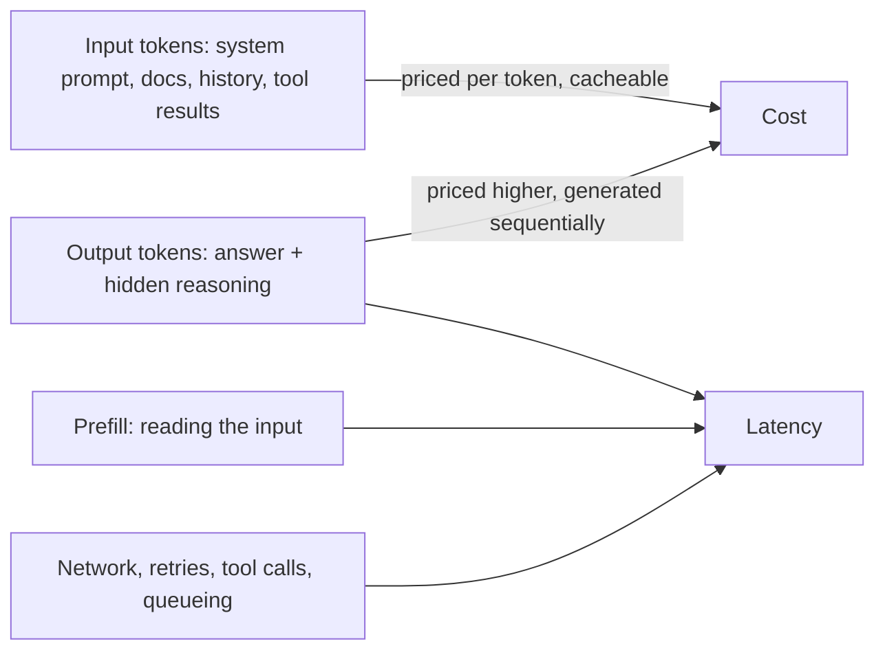
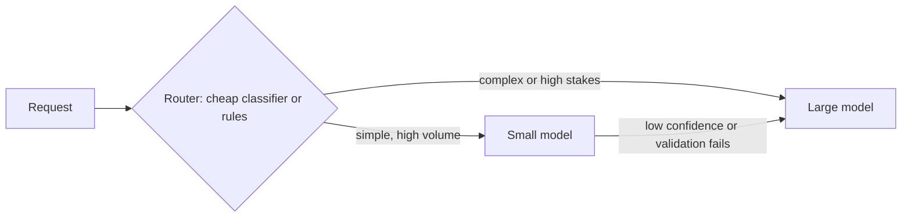

# Cost and Latency Control for LLM Apps

**In one line:** Measure cost per completed task and time to first token, then pull the levers in order (free wins like caching, batching and trimming tokens first; trade-offs like smaller models, lower effort and routing second) and re-check quality after every change.
**Last reviewed:** 2026-10-21

---

## The short version

- **Measure the right unit.** Cost per *completed task* (not per request) and latency at the 95th percentile (not the average). A cheap call that needs three retries is not cheap.
- **Output tokens cost more and take longer than input tokens.** On most current APIs output is priced several times higher than input, and it is generated one token at a time. Shorter answers are the fastest win on both axes.
- **Free wins first**: prompt caching, batching non-urgent work, trimming bloated prompts and history, streaming, and capping output length.
- **Trade-offs second**: smaller or cheaper models, lower reasoning effort, routing easy traffic to cheap models, and self-hosting at scale. Each can cost quality, so each needs an eval.
- **Put a budget in code.** Per user, per feature, per day. Alerts on spend anomalies catch loops and abuse.

## Where the money and time go

- **Time to first token (TTFT)** is mostly prefill (reading the input) plus queueing. Long prompts raise it; caching cuts it.
- **Total time** is TTFT plus output length divided by generation speed. Long answers and long hidden reasoning dominate.
- **Reasoning models** think before answering, and that thinking is billed as output tokens. See [reasoning models](../../explainers/concepts/reasoning-models.md).

For the economics behind provider pricing, read [inference economics](../../explainers/compute/inference-economics.md). For how serving systems get their speed, see [PagedAttention / vLLM](../../papers/techniques/52-pagedattention-vllm/summary.md), [speculative decoding](../../papers/techniques/45-speculative-decoding/summary.md), [FlashAttention](../../papers/techniques/16-flash-attention/summary.md) and the [KV cache](../../explainers/concepts/kv-cache.md).

## Step 0: instrument

Log for every call: model, input tokens, cached tokens, output tokens, latency, TTFT, feature name, user or tenant, and whether the task succeeded. Without this, every optimisation is a guess. See [LLMOps and observability](llmops-observability.md).

A quick worked baseline (prices are Anthropic list prices as of 2026-10):

| Feature | Model | Avg in / out tokens | Calls per day | Daily cost |
|---|---|---|---|---|
| Support chat | Claude Sonnet 5.5 ($2 / $10 per M) | 12,000 / 400 | 20,000 | $480 + $80 = $560 |
| Ticket tagging | Claude Sonnet 5.5 | 1,500 / 50 | 50,000 | $150 + $25 = $175 |

That is about $22,000 a month. Now apply the levers.

## The levers, in order

### 1. Prompt caching (free win)

Caching lets the provider reuse a prompt prefix it has processed recently. Cached input is billed at a fraction of the normal rate and processes faster. As of 2026-10, on Anthropic's Sonnet 5.5 and Opus 5.5, a cache hit costs 5% of the base input price; cache writes cost a premium (1.25x for the 5-minute cache). OpenAI and Google also discount cached input.

To get hits: put stable content first (system prompt, tool definitions, reference docs), volatile content last, and never put a timestamp or request ID in the system prompt. Verify by checking the cached-token count in the usage response. See [prompt caching](../../learn/concepts/prompt-caching.md).

*Example:* if 10,000 of the support chat's 12,000 input tokens are a stable prefix, input cost drops from $480 to roughly $80 to $100 a day.

### 2. Batch anything nobody is waiting for (free win)

Batch APIs process requests asynchronously, typically within 24 hours, at a discount. Anthropic's Batch API is 50% off both input and output as of 2026-10; OpenAI and Google offer comparable batch discounts. Nightly classification, evals, backfills and report generation all qualify.

*Example:* if ticket tagging can wait an hour, batching cuts $175 to about $88 a day.

### 3. Trim tokens (free win)

- **Output caps and format**: ask for "a one-word label", "under 80 words", or JSON with only the needed fields. Set `max_tokens` sensibly.
- **History**: keep the last N turns plus a summary. See [context windows and management](../../learn/concepts/context-windows-and-management.md).
- **Retrieval**: 5 well-ranked chunks beat 20 mediocre ones on cost and often on quality. See [advanced RAG patterns](advanced-rag-patterns.md).
- **Tool results**: return the fields the model needs, not whole API payloads.
- **Prompt bloat**: long lists of rules accumulated over months. Delete, then re-run evals.

### 4. Stream (free latency win)

Streaming does not make the full answer faster, but users see the first words in about a second, which changes perceived speed completely. Stream anything a human reads.

### 5. Lower reasoning effort (trade-off)

Most current models expose an "effort" or thinking-budget control. Lower effort means fewer hidden tokens and faster answers. Classification, extraction and chat often hold quality at low effort; coding and multi-step agent work usually need more. Tune per route, with an eval.

### 6. Smaller model, or routing (trade-off)

Price spreads within one provider's lineup are large. As of 2026-10, Anthropic's Haiku 5.5 starts at $0.10 / $0.50 per million tokens against Sonnet 5.5 at $2 / $10, a 20x difference; OpenAI's `gpt-6-luna` is listed at $0.10 / $0.50 against `gpt-6-astra` at $10 / $50, a 100x difference.

Routing works when traffic is genuinely mixed. Measure the misroute rate. Before building a cascade, test the simpler option of the strong model at lower effort; sometimes it matches quality at similar cost with one code path. See [which model for which job](../../tools/decisions/which-model-for-which-job.md).

*Example:* tagging moves to Haiku 5.5 in batch mode: about $4 a day instead of $175.

### 7. Response caching (situational)

If many users ask identical questions (an FAQ bot), cache final answers keyed on the normalised question. Semantic caching (match similar questions by embedding) is riskier: a near-match can return a wrong answer. Use it only where a wrong cached answer is low-harm.

### 8. Self-host or fine-tune (at scale)

At high, steady volume, running an open-weight model on your own GPUs can beat API prices, if you can keep utilisation high and have the operations skills. A small fine-tuned model can replace a large general one on a narrow task. See [LLM serving](../../tools/decisions/llm-serving.md), [run Llama on a single GPU](../projects/run-llama-on-single-gpu.md), [quantization and distillation](../../learn/concepts/quantization-and-distillation.md), [fine-tune with LoRA](../projects/fine-tune-with-lora.md) and [build vs buy](../../tools/decisions/build-vs-buy.md).

## Latency-specific levers

| Lever | Helps | Notes |
|---|---|---|
| Streaming | Perceived latency | Always, for human-facing output |
| Shorter prompts / caching | TTFT | Caching reduces prefill time too |
| Shorter outputs | Total time | Biggest lever for total time |
| Lower effort / no reasoning | Total time | Check quality |
| Faster model tier | Total time | Smaller models generate faster |
| Parallel calls | Wall time | Run independent sub-tasks concurrently |
| Priority or "fast" tiers | TTFT, throughput | Several providers sell faster serving at a premium; Anthropic offers a fast mode on some Opus models as of 2026-10 |
| Region and routing | Network time | Call a nearby region; avoid cross-ocean hops |
| Speculative UI | Perceived latency | Show a skeleton, partial results, or progress steps for agents |

## Budgets and guardrails

- **Per-request**: `max_tokens`, agent step limits, task token budgets.
- **Per-user**: daily token or dollar quota, enforced in your gateway.
- **Per-feature**: monthly budget with alerts at 50%, 80% and 100%.
- **Anomaly alerts**: a sudden 5x in cost per task usually means a loop, a prompt regression, or abuse.

## Worked result

| Feature | Before | After | Levers |
|---|---|---|---|
| Support chat | $560 / day | about $160 / day | Caching, history trimming, shorter answers |
| Ticket tagging | $175 / day | about $4 / day | Smaller model, batch |
| **Monthly** | **about $22,000** | **about $5,000** | Same quality on evals (verify this, every time) |

The figures are illustrative arithmetic from list prices, not a benchmark. Your mix will differ. The method is the point: measure, apply one lever, re-run evals, keep it only if quality holds.

## Common mistakes

- **Optimising cost per request instead of per task.** Cheaper calls that fail more often cost more.
- **Switching to a smaller model without an eval.** Quality drops show up weeks later as complaints.
- **Dynamic content at the top of the prompt.** One timestamp kills every cache hit.
- **Ignoring hidden reasoning tokens.** A reasoning model at maximum effort on a classification task burns money for nothing.
- **No per-user limits.** One script hitting your endpoint can spend a month's budget overnight.

## Next steps

- [LLMOps and observability](llmops-observability.md) to get the numbers this page depends on
- [Which model for which job](../../tools/decisions/which-model-for-which-job.md)
- [LLM app architecture](llm-app-architecture.md) for where the gateway and budgets live
- Background: [inference economics](../../explainers/compute/inference-economics.md), [GPUs for AI](../../learn/concepts/gpus-for-ai.md), [inference servers](../../learn/concepts/inference-servers.md)

## Sources

- Anthropic, Pricing (Sonnet 5.5, Haiku 5.5, cache multipliers, Batch API 50%, fast mode; as of 2026-10): https://platform.claude.com/docs/en/about-claude/pricing
- Anthropic, Prompt caching: https://platform.claude.com/docs/en/build-with-claude/prompt-caching
- Anthropic, Effort parameter: https://platform.claude.com/docs/en/build-with-claude/effort
- OpenAI, Models (gpt-6-astra and gpt-6-luna list prices; as of 2026-10): https://developers.openai.com/api/docs/models
- Google, Gemini API pricing (batch and caching options; as of 2026-10): https://ai.google.dev/gemini-api/docs/pricing
