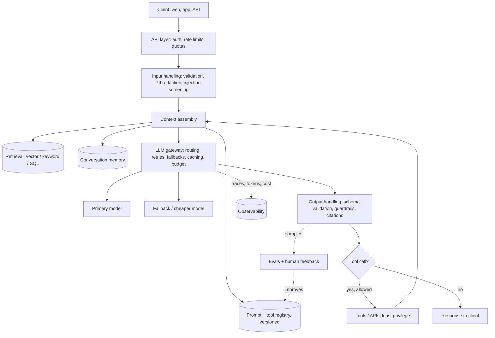

# LLM Application Architecture

**In one line:** A production LLM app is a normal web service with five extra layers (a gateway, prompt and context assembly, the model call, output checks, and an evaluation and feedback loop), and most failures happen in those layers, not in the model.
**Last reviewed:** 2026-10-21

---

## The short version

- The model is one component. Around it you need: **input handling** (auth, rate limits, input checks), **context assembly** (system prompt, retrieved data, history, tools), the **model call** through a **gateway** (routing, retries, fallbacks, cost tracking), **output handling** (validation, guardrails, formatting), and **observability plus evals**.
- Pick the simplest shape that works, in this order: single call, then a fixed **workflow** of calls, then retrieval, then an **agent**. Each step up adds cost, latency and new failure modes.
- Treat prompts, tool definitions and model versions as **versioned configuration**, not string literals scattered through code.
- Everything the model reads from outside your control is untrusted. Design so a misbehaving model cannot do serious harm: least privilege for tools, approval for consequential actions.
- You cannot improve what you do not measure. Ship with tracing and a small eval set on day one.

## The reference architecture

You will not build all of this for a prototype. You should know where each box would go, so you add them in the right place when you need them.

## Layer by layer

### 1. API layer

A normal backend: authentication, per-user rate limits, request size limits, and quotas. LLM calls are expensive, so a single abusive user can cost real money. Put **per-user token or dollar budgets** here, not just request counts.

### 2. Input handling

- **Validate** length and type before anything reaches a model.
- **Redact or tokenise personal data** if your data policy requires it. Decide this with your legal or privacy team, not ad hoc.
- **Screen untrusted content** (uploaded files, fetched web pages) for prompt injection, and mark it as data. See [prompt injection defense](../../safety/security/prompt-injection-defense.md).

### 3. Context assembly

This is where most quality is won or lost. The model can only use what is in its context window.

- **System prompt** from a versioned store, so you can roll back.
- **Retrieved context** from search, a vector store or a database. See [RAG explained](../../learn/concepts/rag-explained.md) and [advanced RAG patterns](advanced-rag-patterns.md).
- **Conversation memory**, trimmed or summarised so it does not grow forever. See [context windows and management](../../learn/concepts/context-windows-and-management.md).
- **Tool definitions**, only the tools this request needs.
- **Order for caching**: stable content first (system prompt, tool list, long reference docs), volatile content last. Prompt caching is a prefix match, so this ordering can cut input cost dramatically. See [prompt caching](../../learn/concepts/prompt-caching.md).

### 4. The LLM gateway

One internal service (or library) that every model call goes through. It is the single most useful piece of infrastructure in an LLM app.

| Responsibility | Why |
|---|---|
| Provider abstraction | Swap or add models without touching business logic |
| Retries with backoff | Rate limits and transient 5xx errors are normal |
| Fallbacks | Primary model down or refusing? Route to a second |
| Routing | Cheap model for easy requests, strong model for hard ones |
| Budgets | Hard stop per user, feature, or day |
| Logging and tracing | Every prompt, response, token count, latency and cost |
| Caching | Prompt caching settings, plus optional response caching for repeated identical requests |

You can build it yourself, use an open-source proxy, or use your cloud's managed gateway. See [GenAI platforms](../../tools/comparisons/genai-platforms.md) and [cost and latency control](cost-and-latency-control.md).

### 5. Output handling

- **Structured outputs** when code consumes the result. See [structured outputs](../../learn/concepts/structured-outputs.md).
- **Business-rule validation** the schema cannot express (totals add up, dates are in range).
- **Guardrails**: content policy checks, PII leakage checks, grounding checks ("is every claim supported by the retrieved text?"). See [guardrails and safety](../../learn/concepts/guardrails-and-safety.md).
- **Citations** back to source documents, so users can check.

### 6. Tools and actions

If the model can call tools, the tool layer is a security boundary. Give each tool the narrowest permissions possible, validate every argument in code, and require human confirmation for anything irreversible or external (payments, emails, deletes). See [agent architectures](agent-architectures.md) and [agent security](../../safety/security/agent-security.md).

### 7. Observability and evals

Trace every request end to end, sample outputs for review, and keep an **offline eval set** you run before any prompt or model change. See [LLMOps and observability](llmops-observability.md) and [set up an eval harness](../projects/set-up-eval-harness.md).

## Choosing the shape: the complexity ladder

Anthropic's widely cited guidance, [Building Effective Agents](../../papers/essays/115-building-effective-agents/summary.md), argues for starting with the simplest pattern that works. In practice:

| Shape | What it is | Use when | Watch out for |
|---|---|---|---|
| **Single call** | One prompt, one response | Classification, extraction, summarisation, rewriting | Over-long prompts doing five jobs at once |
| **Prompt chain** | Fixed sequence: outline, then draft, then check | The task splits into clear steps | Errors compounding down the chain |
| **Router** | A cheap classifier picks the handler or model | Mixed traffic with distinct types | Misroutes; measure them |
| **Retrieval-augmented** | Search first, then answer from results | Answers depend on private or fresh data | Retrieval quality is now your ceiling |
| **Parallel / voting** | Several calls at once, then combine | Independent sub-tasks, or reliability by agreement | Cost multiplies |
| **Agent** | Model decides which tools to call, in a loop, until done | Open-ended tasks where steps cannot be fixed in advance | Cost, latency, unpredictability, security |

Move up only when the step below demonstrably fails on your evals.

## Deployment choices

| Decision | Options | Lean towards |
|---|---|---|
| Where the model runs | Provider API; cloud platform (Bedrock, Vertex AI, Foundry); self-hosted open weights | Provider or cloud API until volume, privacy or latency forces self-hosting. See [LLM serving](../../tools/decisions/llm-serving.md) |
| Sync vs async | Request/response; streaming; background jobs; batch | Stream anything a human waits for; batch anything nobody waits for |
| State | Stateless with history in your DB; provider-managed sessions | Own your history so you can switch providers |
| Multi-tenant data | Shared index with filters; index per tenant | Filters plus tests that prove isolation; per-tenant for strict customers |

## Worked example: a support assistant

1. **API layer**: logged-in customers only; 30 messages per hour each.
2. **Input**: redact card numbers with a regex before anything else.
3. **Context**: system prompt v12 from the prompt store, top 5 help-centre chunks from hybrid search, the customer's last three orders from the orders API, the last 10 turns.
4. **Gateway**: a fast mid-tier model by default; route to a stronger model when the router flags "billing dispute"; fall back to a second provider on errors.
5. **Output**: must cite at least one help article or say it does not know; a refund promise triggers a hand-off instead of a reply.
6. **Tools**: read-only order lookup. Refunds go to a human queue, never executed by the model.
7. **Observability**: every conversation traced; 2% sampled for weekly human review; thumbs-down conversations go into the eval set.

See [customer support automation](../../work/use-cases/customer-support-automation.md) for the business side.

## Common mistakes

- **Prompts as string literals in code.** You cannot version, diff, or roll them back. Move them to config.
- **No gateway.** Every team calls providers directly, nobody knows the bill, and switching models takes a quarter.
- **Agent first.** A fixed workflow would have been cheaper, faster and easier to test.
- **Treating the system prompt as a security control.** It is guidance. Enforce permissions in code.
- **Shipping without evals.** The first model upgrade silently breaks something and nobody notices for a month.
- **Ignoring tail latency.** Average latency looks fine; the 95th percentile, with long outputs and retries, is what users remember.

## Next steps

- [Agent architectures](agent-architectures.md), [advanced RAG patterns](advanced-rag-patterns.md), [cost and latency control](cost-and-latency-control.md), [LLMOps and observability](llmops-observability.md)
- The generic ML pipeline view: [AI/ML pipeline](ai-ml-pipeline.md)
- Hands-on: [chatbot in an afternoon](../projects/chatbot-in-an-afternoon.md), [build a RAG pipeline](../projects/build-rag-pipeline.md)
- Background: [inference economics](../../explainers/compute/inference-economics.md), [agent protocols](../../explainers/ecosystem/agent-protocols.md), [open-source stack](../../explainers/ecosystem/open-source-stack.md)

## Sources

- Anthropic, "Building effective agents" (Dec 2024): https://www.anthropic.com/engineering/building-effective-agents
- Anthropic, Prompt caching (prefix matching, ordering): https://platform.claude.com/docs/en/build-with-claude/prompt-caching
- OWASP, Top 10 for LLM Applications: https://genai.owasp.org/llm-top-10/
- Chip Huyen, "Building A Generative AI Platform" (2024): https://huyenchip.com/2024/07/25/genai-platform.html
