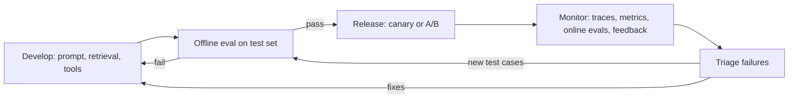
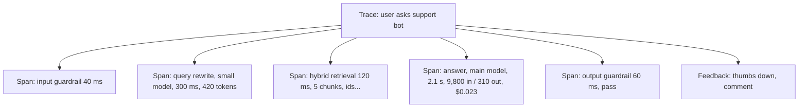

# LLMOps and Observability

**In one line:** Run LLM features like any production service (traces, metrics, alerts, versioned releases) plus three LLM-specific loops: offline evals before every change, online quality monitoring after, and a path from user feedback back into the eval set.
**Last reviewed:** 2026-10-21

---

## The short version

- **LLMOps** is MLOps for systems built on foundation models. You rarely train the model, so the work shifts to **prompts, retrieval, tools, model versions and evaluation**.
- **Trace every request** end to end: the user input, every model call (prompt, response, tokens, latency, cost), every retrieval and tool call. When something goes wrong, the trace is the only way to know which step failed.
- **Version everything that changes behaviour**: prompt, model ID, tool definitions, retrieval settings. Tag every trace with those versions.
- **Gate releases on offline evals**, then **watch online signals** (user feedback, guardrail triggers, automated quality scores, cost per task) after release.
- Close the loop: bad production examples become new eval cases. Over months, the eval set becomes your most valuable asset.

## The LLMOps lifecycle

Compare with the classical ML lifecycle in [AI/ML pipeline](ai-ml-pipeline.md) and [deploy an ML model](../projects/deploy-ml-model.md). The difference: classical MLOps watches data drift and retrains; LLMOps mostly watches behaviour drift and changes prompts, context or model versions.

## What to trace

A **trace** is one user request; **spans** are the steps inside it.

For each LLM span, capture: model ID, prompt version, full input and output (subject to your data policy), token counts including cached and reasoning tokens, latency and time to first token, cost, stop reason, and any errors or refusals. For retrieval spans, capture the query and the IDs and scores of retrieved chunks, so you can tell retrieval failures from generation failures.

**Use OpenTelemetry where you can.** The OpenTelemetry project maintains semantic conventions for generative AI spans (model, token usage, operation names). Instrumenting to that standard means you can switch observability vendors without re-instrumenting.

## Metrics that matter

| Category | Metrics | Alert when |
|---|---|---|
| Reliability | Error rate, rate-limit rate, timeout rate, fallback rate | Above baseline for 5+ minutes |
| Latency | TTFT and total, p50 / p95 / p99, per feature | p95 regresses after a release |
| Cost | Tokens and dollars per task, per user, per feature; cache hit rate | Cost per task jumps; cache hit rate falls to near zero |
| Quality (automated) | Schema validity, guardrail trigger rate, groundedness score, LLM-judge score on samples | Drops after a change |
| Quality (human) | Thumbs up/down rate, escalation rate, edit distance on drafts users accept | Trend worsens week over week |
| Safety | Injection detections, PII leaks caught, policy refusals | Any spike |
| Agents | Steps per task, tool error rate, budget-exhausted rate | Loops or rising step counts |

## Evaluation: offline and online

**Offline evals** run before a change ships, on a fixed test set: golden question-answer pairs, extraction gold data, adversarial prompts, and regression cases from past incidents. Score with exact match where you can, code checks (does it parse, do the tests pass), and LLM-as-judge with a rubric where you cannot. Calibrate the judge against human labels; see [LLM-as-a-judge](../../papers/techniques/85-llm-as-judge/summary.md). Build one with [set up an eval harness](../projects/set-up-eval-harness.md); concepts in [evals for LLMs](../../learn/concepts/evals-for-llms.md).

**Online evals** run on sampled production traffic after release: automated judges scoring a percentage of traces, guardrail outcomes, and user feedback. They catch what your test set did not anticipate.

**Release patterns:**

- **Canary**: send 5% of traffic to the new prompt or model, compare metrics, then ramp.
- **A/B test**: for product questions (does the new tone raise satisfaction?), with a pre-agreed metric and sample size.
- **Shadow**: run the new version on live inputs without showing users, and compare outputs offline.

## Prompt and config management

Treat prompts like code:

- Stored in version control or a prompt registry, never pasted inline across services.
- Each version has an ID that appears in every trace.
- Changes go through review plus an eval run, like a pull request with tests.
- Rollback is a config change, not a deploy.
- **Pin model versions.** Use explicit model IDs, read your provider's deprecation schedule, and treat a model upgrade as a release that needs evals. As of 2026-10, Anthropic's model IDs are pinned snapshots and its docs publish minimum retirement dates for current models.

## Tooling landscape

As of 2026-10, the common choices fall into a few groups. Details and comparisons are in [LLM observability tools](../../tools/comparisons/llm-observability.md).

| Type | Examples | Notes |
|---|---|---|
| Open-source, self-hostable LLM tracing and evals | Langfuse (MIT), Arize Phoenix, Comet Opik | Keep data in your own infrastructure |
| Framework-tied platforms | LangSmith (LangChain) | Strong if you already use LangChain or LangGraph |
| Eval-focused platforms | Braintrust, DeepEval, promptfoo | Test sets, scoring, CI integration |
| General observability with LLM features | Datadog, Grafana, cloud-native monitoring | Fits existing on-call workflows |
| Cloud platform built-ins | Bedrock, Vertex AI, Foundry monitoring | Easiest if you are all-in on one cloud |

A sensible starting stack: OpenTelemetry instrumentation, one LLM-aware tracing tool, an eval runner in CI, and your existing alerting.

## Incident response for LLM features

1. **Detect**: alert fires (error spike, quality drop, cost spike) or users report.
2. **Find the traces**: filter by time, feature, prompt version, model.
3. **Classify**: provider outage, prompt regression, retrieval failure, data change, abuse or injection, model behaviour change.
4. **Mitigate**: roll back the prompt or model version, switch to a fallback provider, tighten a guardrail, or disable the feature with a flag.
5. **Learn**: add the failing cases to the offline eval set so it cannot regress silently again.

Have a **kill switch** for every LLM feature: a flag that turns it off or routes to a safe fallback without a deploy.

## Privacy and retention

Traces contain user data, often sensitive. Decide up front: what you log in full, what you redact, who can read traces, how long you keep them, and whether the observability vendor stores data in a region your policy allows. Align with your [AI governance program](../../safety/governance/ai-governance-program.md).

## Common mistakes

- **Logging only errors.** Most LLM failures return HTTP 200 with a bad answer. Log content (within policy) and score it.
- **No version tags on traces.** You cannot tell whether last week's prompt change caused today's problem.
- **Floating model aliases in production.** Behaviour changes without a release. Pin versions.
- **An eval set that never grows.** Every incident should add cases.
- **Uncalibrated LLM judges.** A judge that agrees with humans 60% of the time is noise. Check it against labels.
- **Dashboards nobody owns.** Assign an owner and a weekly review.

## Next steps

- [Set up an eval harness](../projects/set-up-eval-harness.md) and [LLM observability tools](../../tools/comparisons/llm-observability.md)
- [Cost and latency control](cost-and-latency-control.md)
- [LLM app architecture](llm-app-architecture.md) for where the gateway and tracing sit
- Background: [contamination and saturation](../../explainers/benchmarks/contamination-and-saturation.md) for why public benchmarks are no substitute for your own evals

## Sources

- OpenTelemetry, Semantic conventions for generative AI systems: https://opentelemetry.io/docs/specs/semconv/gen-ai/
- Langfuse (MIT licence, self-hostable): https://github.com/langfuse/langfuse
- Arize Phoenix: https://github.com/Arize-ai/phoenix
- Comet Opik: https://github.com/comet-ml/opik
- LangSmith docs: https://docs.langchain.com/langsmith/home
- Anthropic, Models overview (pinned snapshot IDs, retirement commitments; as of 2026-10): https://platform.claude.com/docs/en/about-claude/models/overview
- Zheng et al., "Judging LLM-as-a-Judge with MT-Bench and Chatbot Arena" (2023): https://arxiv.org/abs/2306.05685
