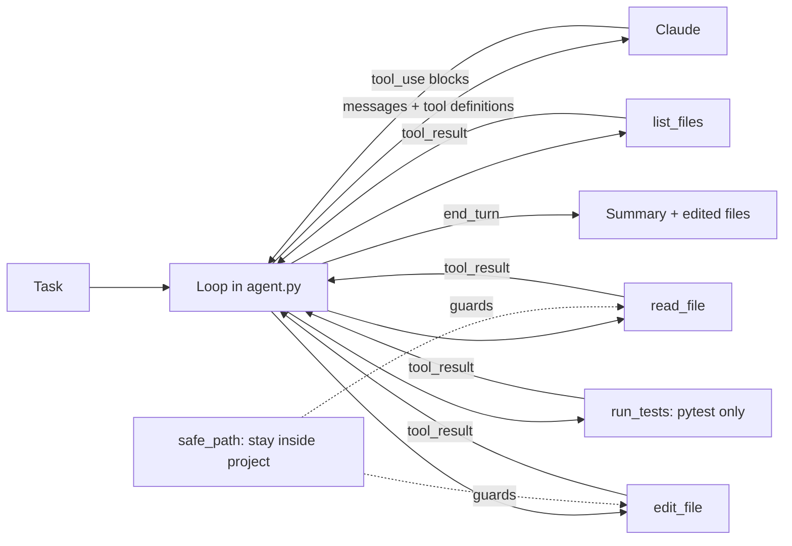

# Build a Coding Agent Loop

**In one line:** Build a working coding agent in under 100 lines of Python (a model in a loop with four tools: list, read, edit, run tests), point it at a small project with failing tests, watch it fix them, and learn which harness decisions make it reliable and safe.
**Last reviewed:** 2026-10-21

---

## The short version

- You will build the core of what tools like Claude Code, Codex and Copilot's cloud agent do: the model asks for a tool, your code runs it, the result goes back, repeat until the tests pass.
- Four tools are enough: `list_files`, `read_file`, `edit_file` (exact search-and-replace) and `run_tests`. No general shell: the agent can run the test suite and nothing else.
- Every file path is checked against the project root, every edit must match exactly once, test output is truncated, and the loop has a step limit. Those four decisions are the difference between a demo and something you can leave running.
- Time: about an hour. Cost: a few cents to tens of cents per run, depending on the model and how many steps it takes.
- When it works: the agent reports what it changed, and `pytest` passes when you run it yourself.

Read [AI coding agents explained](../../learn/concepts/ai-coding-agents-explained.md) first for the why; this page is the how. The general loop is in [Agentic loops](../../learn/concepts/agentic-loops.md).

## Architecture



## Prerequisites

- Python 3.10 or newer
- `pip install anthropic pytest`
- An Anthropic API key in `ANTHROPIC_API_KEY` (see [API keys and environment variables](../../learn/day-one/api-keys-and-env-vars.md)), with a spend limit set

## Step 1: a small project with bugs

Create a folder `shop/` with two files. The code has two bugs; the tests describe the intended behaviour.

`shop/cart.py`:

```python
def total(items, discount_code=None):
    """Sum item prices (in cents). SAVE10 takes 10% off orders of 5000 cents or more."""
    subtotal = sum(price * qty for price, qty in items)
    if discount_code == "SAVE10" and subtotal > 5000:
        subtotal = subtotal * 0.9
    return subtotal
```

`shop/test_cart.py`:

```python
from cart import total

def test_simple_sum():
    assert total([(1000, 2), (500, 1)]) == 2500

def test_discount_applies_at_threshold():
    assert total([(5000, 1)], "SAVE10") == 4500

def test_discount_returns_whole_cents():
    assert total([(3333, 3)], "SAVE10") == 8999

def test_empty_cart():
    assert total([]) == 0
```

Run `python -m pytest -q shop` and you should see `2 failed, 2 passed`. The discount does not apply at exactly 5000 cents (`>` should be `>=`), and the discounted total is a float with a fraction of a cent (`8999.1`) instead of whole cents.

## Step 2: the agent

Save as `agent.py` next to the `shop/` folder:

```python
import json, subprocess, sys
from pathlib import Path
import anthropic

ROOT = Path(sys.argv[1]).resolve()          # the only directory the agent may touch
MODEL = "claude-opus-5"
MAX_STEPS = 25

def safe_path(rel: str) -> Path:
    p = (ROOT / rel).resolve()
    if p != ROOT and ROOT not in p.parents:
        raise ValueError(f"path escapes the project: {rel}")
    return p

def list_files(_: dict) -> str:
    files = [str(p.relative_to(ROOT)) for p in ROOT.rglob("*")
             if p.is_file() and "__pycache__" not in p.parts and ".pytest_cache" not in p.parts]
    return "\n".join(sorted(files))

def read_file(args: dict) -> str:
    lines = safe_path(args["path"]).read_text().splitlines()
    return "\n".join(f"{i:4} {line}" for i, line in enumerate(lines, 1))

def edit_file(args: dict) -> str:
    path = safe_path(args["path"])
    text = path.read_text() if path.exists() else ""
    old, new = args["old"], args["new"]
    if old == "":                              # empty "old" means create the file
        if path.exists():
            return "ERROR: file exists; give the exact text to replace"
        path.write_text(new)
        return f"created {args['path']}"
    count = text.count(old)
    if count != 1:
        return f"ERROR: 'old' text found {count} times; it must match exactly once"
    path.write_text(text.replace(old, new))
    return f"edited {args['path']}"

def run_tests(_: dict) -> str:
    result = subprocess.run([sys.executable, "-m", "pytest", "-q", "--tb=short"],
                            cwd=ROOT, capture_output=True, text=True, timeout=120)
    out = (result.stdout + result.stderr).strip()
    return out[-4000:]                          # keep the tail; that is where failures are

TOOLS = {
    "list_files": (list_files, "List every file in the project.", {}),
    "read_file": (read_file, "Read a file, with line numbers.",
                  {"path": {"type": "string", "description": "Path relative to the project root"}}),
    "edit_file": (edit_file,
                  "Replace one exact snippet in a file with new text. 'old' must appear exactly once. "
                  "Use old='' to create a new file.",
                  {"path": {"type": "string"}, "old": {"type": "string"}, "new": {"type": "string"}}),
    "run_tests": (run_tests, "Run the project's test suite with pytest and return the output.", {}),
}

TOOL_DEFS = [{"name": name, "description": desc,
              "input_schema": {"type": "object", "properties": props, "required": list(props)}}
             for name, (_, desc, props) in TOOLS.items()]

SYSTEM = """You are a careful software engineer working in a small Python project.
Work in small steps: look at the files, read what you need, make a minimal edit, run the tests.
Never edit a test to make it pass unless the task says the test is wrong.
When all tests pass, reply with a short summary of what you changed and why."""

def run(task: str) -> None:
    client = anthropic.Anthropic()
    messages = [{"role": "user", "content": task}]
    for step in range(1, MAX_STEPS + 1):
        resp = client.messages.create(model=MODEL, max_tokens=16000, system=SYSTEM,
                                      tools=TOOL_DEFS, messages=messages)
        messages.append({"role": "assistant", "content": resp.content})
        print(f"--- step {step}: stop_reason={resp.stop_reason} "
              f"in={resp.usage.input_tokens} out={resp.usage.output_tokens}")

        if resp.stop_reason != "tool_use":
            for block in resp.content:
                if block.type == "text":
                    print(block.text)
            return

        results = []
        for block in resp.content:
            if block.type != "tool_use":
                continue
            fn = TOOLS[block.name][0]
            try:
                output, is_error = fn(block.input), False
            except Exception as exc:              # report tool failures to the model
                output, is_error = f"ERROR: {exc}", True
            print(f"[{block.name}] {json.dumps(block.input)[:120]}")
            results.append({"type": "tool_result", "tool_use_id": block.id,
                            "content": output, "is_error": is_error})
        messages.append({"role": "user", "content": results})
    print(f"Stopped: hit the {MAX_STEPS}-step limit.")

if __name__ == "__main__":
    run(" ".join(sys.argv[2:]) or "The test suite is failing. Find out why and fix the code.")
```

What each part is for:

- **`safe_path`** resolves every path and refuses anything outside the project root, so `../../.ssh/id_rsa` fails. Never let a model choose arbitrary paths.
- **`edit_file`** is search-and-replace that must match **exactly once**. Zero matches means the model misremembered the file; several matches means the edit is ambiguous. Both return an error the model can act on (usually by re-reading the file). This is far safer than letting the model rewrite whole files.
- **`run_tests`** runs one fixed command. The model cannot run arbitrary shell commands, which removes most of the damage it could do. Output is cut to the last 4,000 characters because the failures are at the end and a full log would flood the context.
- **Errors go back as `tool_result` with `is_error: true`** rather than crashing the loop, so the agent can recover.
- **The system prompt** asks for small steps and forbids editing tests to make them pass, which is the most common way agents "cheat".
- **`MAX_STEPS`** stops a confused agent from looping forever.
- The model ID follows Anthropic's current documentation as of 2026-10-21; any recent Claude model that supports tool use will work, and a smaller one is cheaper for a task this size.

## Step 3: run it

```bash
python agent.py shop "The test suite is failing. Find out why and fix the code."
```

A typical run looks like this (your step count and token numbers will differ):

```
--- step 1: stop_reason=tool_use in=... out=...
[list_files] {}
--- step 2: stop_reason=tool_use ...
[read_file] {"path": "cart.py"}
[read_file] {"path": "test_cart.py"}
--- step 3: stop_reason=tool_use ...
[run_tests] {}
--- step 4: stop_reason=tool_use ...
[edit_file] {"path": "cart.py", "old": "subtotal > 5000", "new": "subtotal >= 5000"}
[edit_file] {"path": "cart.py", "old": "subtotal = subtotal * 0.9", "new": "subtotal = round(subtotal * 0.9)"}
--- step 5: stop_reason=tool_use ...
[run_tests] {}
--- step 6: stop_reason=end_turn ...
Fixed two bugs in cart.py: the SAVE10 threshold now includes exactly 5000 cents,
and the discounted total is rounded to whole cents. All 4 tests pass.
```

The model may read several files in one step (parallel tool calls); the loop handles that by returning all results in one message.

## Verification

- `python -m pytest -q shop` passes when **you** run it.
- `git diff` (or comparing to your original) shows a small change to `cart.py` and **no change to `test_cart.py`**.
- The step log shows the agent ran the tests after editing, not just before.
- Ask it to read `../agent.py` and confirm it gets `path escapes the project`.

## Extend it

1. **A search tool.** Add `grep(pattern)` over the project; on real codebases agents search far more than they list.
2. **Token and cost accounting.** Sum `resp.usage` across steps and print a dollar figure using [AI cost basics](../../learn/concepts/ai-cost-basics.md). Notice how the input tokens grow every step as the conversation is resent, then add [prompt caching](../../learn/concepts/prompt-caching.md) for the system prompt and tool definitions.
3. **A project instructions file.** Read `AGENTS.md` or `CLAUDE.md` from the project root, if present, and append it to the system prompt.
4. **A human approval gate.** Before each `edit_file`, print the change and ask `y/n`.
5. **Run it in a container** with no network and only the project mounted, then consider allowing a broader shell.
6. **Evaluate it.** Make ten small broken projects and measure how often it fixes them: [Evaluate an agent end to end](evaluate-an-agent-end-to-end.md).
7. **Compare with a real harness.** The [Claude Agent SDK](https://code.claude.com/docs/en/agent-sdk/overview) ships these tools (and many more) with permissions and hooks built in; [Build a Claude agent with MCP](build-claude-agent-with-mcp.md) shows another route.

## Common mistakes

- **Giving it a general shell on your own machine** in the first version. Start with fixed commands; widen access inside a sandbox.
- **Letting it rewrite whole files.** Exact replacements keep diffs small and catch stale reads.
- **Dropping tool errors.** If a tool fails and you do not return a `tool_result`, the API rejects the next request; if you raise, the run dies. Return the error as text.
- **Returning huge outputs.** A full test log or a 3,000-line file every step makes runs slow and expensive. Truncate and paginate.
- **Trusting the summary.** The model's final message describes what it believes it did. Check the diff and run the tests yourself.

## Next steps

- [Evaluate an agent end to end](evaluate-an-agent-end-to-end.md)
- [AI coding agents explained](../../learn/concepts/ai-coding-agents-explained.md) and [Agent security](../../safety/security/agent-security.md)
- [Coding assistants compared](../../tools/comparisons/coding-assistants.md) and [Coding assistants in practice](../../work/use-cases/coding-assistants-in-practice.md)
- Papers: [SWE-bench](../../papers/techniques/84-swe-bench/summary.md), [ReAct](../../papers/techniques/21-react/summary.md), [Building Effective Agents](../../papers/essays/115-building-effective-agents/summary.md)

## Sources

- Anthropic, "How to implement tool use" (tool_use and tool_result blocks, `is_error`, parallel tool results in one message): https://platform.claude.com/docs/en/agents-and-tools/tool-use/implement-tool-use
- Anthropic, text editor tool (the search-and-replace edit pattern): https://platform.claude.com/docs/en/agents-and-tools/tool-use/text-editor-tool
- Anthropic, models overview: https://platform.claude.com/docs/en/about-claude/models/overview
- Tested on 2026-10-21: the tools, path guard and loop were run end to end with a scripted stand-in for the model (the bugs are fixed and all four tests pass); the call to the live API itself was not run for this page, so the sample output above is illustrative.
