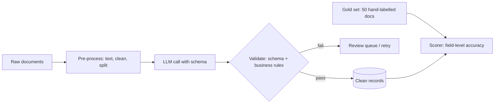

# Build a Structured Extraction Pipeline

**In one line:** Turn messy text (invoices, emails, contracts) into validated, typed records with a schema, a cheap model, a gold test set and the batch API, and know your field-level accuracy before anyone relies on the data.
**Last reviewed:** 2026-10-21

---

## The short version

- Extraction is the most common and most reliable business use of LLMs: text in, clean JSON out. It replaces brittle regex and manual data entry.
- You will define the output as a **Pydantic schema**, call the model with **structured outputs** so the response is guaranteed to match it, add **business-rule validation** the schema cannot express, and score the pipeline against a **hand-labelled gold set**.
- For volume, you will switch to the **Message Batches API**, which is 50% cheaper and returns results within hours instead of seconds.
- Time: 3 to 4 hours. Cost: a few cents for development with `claude-haiku-5-5`; about $0.10 per thousand short documents in batch mode (worked out below).
- The output of the project is not the code. It is a number: "field accuracy 97.4% on 50 gold documents, totals 100%, dates 94%", plus a list of what fails.

## What you are building



Concepts used: [structured outputs](../../learn/concepts/structured-outputs.md), [prompt engineering](../../learn/concepts/prompt-engineering.md), and [evals for LLMs](../../learn/concepts/evals-for-llms.md). The paper that showed models could do zero-shot tasks like this from instructions alone is [FLAN](../../papers/techniques/80-flan/summary.md); [GPT-3](../../papers/language-models/04-gpt3-few-shot-learners/summary.md) showed it from examples in the prompt.

## Prerequisites

- Python 3.10+, `pip install anthropic pydantic`
- `ANTHROPIC_API_KEY` set
- 50 or more real example documents of one type. Supplier invoices or inbound support emails are good first choices. Remove anything you are not allowed to send to a third-party API, or run the same pattern against a [local model](../../tools/comparisons/local-llm-runners.md).

## Cost estimate

Model: `claude-haiku-5-5`, which Anthropic positions for "classification, extraction, and routing". As of 2026-10 it costs $0.10 per million input tokens and $0.50 per million output tokens for prompts up to 100,000 tokens, and the Batch API halves that.

| Volume | Tokens per doc (in / out) | Real-time cost | Batch cost |
|---|---|---|---|
| 50 gold docs, 5 dev runs | 1,500 / 300 | about $0.08 | - |
| 1,000 docs | 1,500 / 300 | about $0.30 | about $0.15 |
| 100,000 docs a month | 1,500 / 300 | about $30 | about $15 |

If accuracy on your gold set is not good enough, step up to `claude-sonnet-5-5` ($2 / $10 as of 2026-10), which is 20 times the price. Measure before you pay for it.

## Step 1: design the schema first

The schema is the contract with everyone downstream. Spend real time here.

```python
# schema.py
from datetime import date
from enum import Enum
from typing import Optional
from pydantic import BaseModel, ConfigDict, Field

class Currency(str, Enum):
    USD = "USD"
    EUR = "EUR"
    GBP = "GBP"
    OTHER = "OTHER"

class LineItem(BaseModel):
    model_config = ConfigDict(extra="forbid")
    description: str
    quantity: float
    unit_price: float
    amount: float

class Invoice(BaseModel):
    model_config = ConfigDict(extra="forbid")
    supplier_name: str
    invoice_number: str
    invoice_date: date
    due_date: Optional[date] = Field(description="null if not stated")
    currency: Currency
    subtotal: float
    tax: float
    total: float
    line_items: list[LineItem]
    notes_for_reviewer: Optional[str] = Field(
        description="Anything ambiguous or missing. null if none.")
```

Design rules that save pain later:

- **Make "unknown" representable.** `Optional[...]` with "null if not stated" stops the model inventing a due date to fill a required field. This one choice prevents a large share of extraction [hallucinations](../../learn/concepts/hallucinations.md).
- **Use enums** for anything with a fixed set of values.
- **Give the model an escape hatch.** `notes_for_reviewer` lets it flag doubt instead of guessing silently.
- **Keep numeric checks out of the schema.** As of 2026-10, Anthropic's structured outputs do not support numeric constraints such as `minimum`, or string length limits. Enforce those in step 3.
- `extra="forbid"` makes Pydantic emit `additionalProperties: false`, which strict schemas require.

## Step 2: extract one document

```python
# extract.py
import anthropic
from schema import Invoice

client = anthropic.Anthropic()
MODEL = "claude-haiku-5-5"

INSTRUCTIONS = """Extract the invoice fields from the document.
- Copy numbers exactly as printed; do not recompute them.
- Dates as YYYY-MM-DD.
- If a field is not present, use null. Never guess.
- Put anything unclear in notes_for_reviewer."""

def extract(text: str) -> Invoice:
    resp = client.messages.parse(
        model=MODEL,
        max_tokens=4096,
        system=INSTRUCTIONS,
        messages=[{"role": "user", "content": f"<document>\n{text}\n</document>"}],
        output_format=Invoice,
    )
    return resp.parsed_output

if __name__ == "__main__":
    import sys
    print(extract(open(sys.argv[1]).read()).model_dump_json(indent=2))
```

`messages.parse` sends your Pydantic class as a JSON schema, constrains generation to it, and hands back a typed `Invoice`. Structured outputs guarantee the **shape**. They do not guarantee the **values** are right. That is what the next two steps are for.

For PDFs, either extract the text first (`pypdf`, or a document-AI service) or send the PDF itself as a document content block; Claude models accept PDF input directly. Scanned images need the vision path. See [multimodal models](../../learn/concepts/multimodal-models.md).

## Step 3: validate business rules

```python
# validate.py
from schema import Invoice

def problems(inv: Invoice) -> list[str]:
    errs = []
    if abs(inv.subtotal + inv.tax - inv.total) > 0.02:
        errs.append(f"subtotal + tax != total ({inv.subtotal} + {inv.tax} vs {inv.total})")
    line_sum = round(sum(li.amount for li in inv.line_items), 2)
    if inv.line_items and abs(line_sum - inv.subtotal) > 0.02:
        errs.append(f"line items sum {line_sum} != subtotal {inv.subtotal}")
    for li in inv.line_items:
        if abs(li.quantity * li.unit_price - li.amount) > 0.02:
            errs.append(f"line '{li.description[:30]}' qty x price != amount")
    if inv.due_date and inv.due_date < inv.invoice_date:
        errs.append("due date before invoice date")
    if inv.total < 0:
        errs.append("negative total")
    return errs
```

Every document now lands in one of three buckets: clean, flagged by the model (`notes_for_reviewer` not null), or failing a rule. Only the first goes straight through. This is the [human-in-the-loop](../patterns/llm-app-architecture.md) pattern in its simplest form, and it is where most real accuracy comes from: arithmetic checks catch extraction errors that no prompt fix will.

## Step 4: build a gold set and score it

Hand-label 50 documents into JSON files that match the schema. It takes an afternoon and is the most valuable afternoon in the project. Include the ugly ones: multi-page, handwritten notes, foreign currency, credit notes.

```python
# score.py
import json
from pathlib import Path
from collections import Counter
from extract import extract
from validate import problems

FIELDS = ["supplier_name", "invoice_number", "invoice_date", "due_date",
          "currency", "subtotal", "tax", "total"]

def norm(v):
    if isinstance(v, str):
        return " ".join(v.lower().split())
    if isinstance(v, float):
        return round(v, 2)
    return v

right, total, flagged = Counter(), Counter(), 0
for gold_path in sorted(Path("gold").glob("*.json")):
    gold = json.loads(gold_path.read_text())
    doc = Path("docs", gold_path.stem + ".txt").read_text()
    inv = extract(doc)
    got = json.loads(inv.model_dump_json())
    if problems(inv) or got.get("notes_for_reviewer"):
        flagged += 1
    for f in FIELDS:
        total[f] += 1
        if norm(got.get(f)) == norm(gold.get(f)):
            right[f] += 1
        else:
            print(f"{gold_path.stem} {f}: got {got.get(f)!r} want {gold.get(f)!r}")

for f in FIELDS:
    print(f"{f:16s} {right[f]}/{total[f]} = {right[f]/total[f]:.0%}")
print(f"overall {sum(right.values())}/{sum(total.values())}; flagged for review: {flagged}")
```

Read every miss. Typical findings: the supplier name differs only in "Ltd" vs "Limited" (fix the normaliser, not the model); dates in DD/MM vs MM/DD (add the supplier's locale to the prompt); line items merged across pages (send pages together). Change one thing, re-score, keep the change only if the number goes up. This loop is [eval-driven development](set-up-eval-harness.md).

## Step 5: scale with the Batch API

When the pipeline is good enough, process the backlog at half price. Batches run asynchronously; most finish well within 24 hours.

```python
# batch.py
import json, time
from pathlib import Path
import anthropic
from schema import Invoice
from extract import INSTRUCTIONS, MODEL

client = anthropic.Anthropic()
schema = Invoice.model_json_schema()
docs = sorted(Path("backlog").glob("*.txt"))

batch = client.messages.batches.create(requests=[
    {
        "custom_id": p.stem,
        "params": {
            "model": MODEL,
            "max_tokens": 4096,
            "system": INSTRUCTIONS,
            "messages": [{"role": "user", "content": f"<document>\n{p.read_text()}\n</document>"}],
            "output_config": {"format": {"type": "json_schema", "schema": schema}},
        },
    }
    for p in docs
])

while client.messages.batches.retrieve(batch.id).processing_status != "ended":
    time.sleep(60)

out = Path("extracted"); out.mkdir(exist_ok=True)
for result in client.messages.batches.results(batch.id):
    if result.result.type == "succeeded":
        text = "".join(b.text for b in result.result.message.content if b.type == "text")
        inv = Invoice.model_validate_json(text)
        (out / f"{result.custom_id}.json").write_text(inv.model_dump_json(indent=2))
    else:
        print(result.custom_id, result.result.type)
```

Results come back **in any order**. Always key them by `custom_id`, never by position.

## How to know it worked

- You have a per-field accuracy table on a gold set you did not tune on blindly (keep 10 documents aside as a final check you only run at the end).
- Business-rule failures and model flags route to a review queue, and you know what share of documents that is.
- Running the scorer is one command, so you can test a new model or prompt in minutes.
- The batch job's output count matches the input count, and every failure is logged with its ID.

## Extend it

- **Classify, then extract.** Route each document to the right schema (invoice, receipt, credit note) with a cheap classification call first.
- **Confidence by agreement.** Extract twice (or with two models) and send disagreements to review. A cheap form of [self-consistency](../../papers/techniques/77-self-consistency/summary.md).
- **Citations.** Ask for the source text span for each field so reviewers can check quickly.
- **Fine-tune a small model** once you have thousands of verified records. See [fine-tune with LoRA](fine-tune-with-lora.md) and [fine-tuning vs RAG](../../learn/concepts/fine-tuning-vs-rag.md).
- **Business use cases.** See [document processing](../../work/use-cases/document-processing.md) for how teams roll this out.

## Common mistakes

- **Required fields with no "unknown" option.** The model will invent a value rather than violate the schema.
- **Trusting valid JSON as correct data.** Schema validity is not accuracy. Score against gold.
- **No arithmetic checks.** Totals that do not add up are the cheapest error signal you will ever get.
- **Tuning on the whole gold set.** You will overfit the prompt. Hold some back.
- **Sending data you are not allowed to send.** Check your data agreement and the provider's retention terms first. See [acceptable use policy](../../work/enablement/acceptable-use-policy.md).

## Next steps

- [Set up an eval harness](set-up-eval-harness.md) to make the scorer a proper regression suite.
- [Cost and latency control](../patterns/cost-and-latency-control.md) for routing, caching and batching at scale.
- [LLMOps and observability](../patterns/llmops-observability.md) to watch accuracy drift in production.

## Sources

- Anthropic, Structured outputs (supported models incl. Haiku 5.5, `messages.parse` with `output_format`, schema limitations; as of 2026-10): https://platform.claude.com/docs/en/build-with-claude/structured-outputs
- Anthropic, Models overview (Haiku 5.5 positioning): https://platform.claude.com/docs/en/about-claude/models/overview
- Anthropic, Pricing (Haiku 5.5, Sonnet 5.5, Batch API 50% discount; as of 2026-10): https://platform.claude.com/docs/en/about-claude/pricing
- Anthropic, Batch processing: https://platform.claude.com/docs/en/build-with-claude/batch-processing
- Anthropic, PDF support: https://platform.claude.com/docs/en/build-with-claude/pdf-support
- Pydantic, model config `extra="forbid"`: https://docs.pydantic.dev/latest/api/config/
