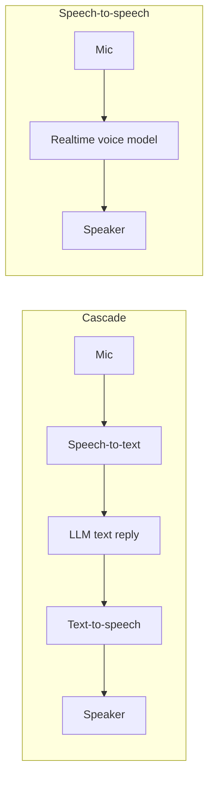

# Build a Voice Agent

**In one line:** Build a push-to-talk voice assistant from three swappable parts (speech-to-text, an LLM, text-to-speech), measure where the latency goes, and learn when to switch to a speech-to-speech model instead.
**Last reviewed:** 2026-10-21

---

## The short version

- A voice agent is usually a **cascade**: speech-to-text (STT) turns audio into words, an LLM decides what to say, and text-to-speech (TTS) speaks it. The alternative is a **speech-to-speech** model that takes audio in and gives audio out directly.
- You will build the cascade in about 80 lines of Python: local transcription with [faster-whisper](https://github.com/SYSTRAN/faster-whisper), Claude for the reply, and offline TTS with `pyttsx3`. Only the LLM step leaves your machine.
- The thing that makes voice hard is **latency**. People expect a reply in well under a second or two. You will time every stage and then cut the delay by streaming the reply sentence by sentence.
- Time: 3 to 4 hours. Cost: a few cents of API usage; transcription and speech run locally for free.
- When it works: you press Enter, speak, and hear a relevant spoken answer starting within about two seconds, with a printed timing breakdown.

## Two architectures



| | Cascade (this project) | Speech-to-speech |
|---|---|---|
| Latency | Sum of three stages; needs streaming to feel natural | Lowest; built for interruption and turn-taking |
| Control | Full: you see and can filter the text at every step | Less: the reasoning and speech happen in one model |
| Model choice | Any STT, any LLM, any voice | Limited to the provider's realtime models |
| Debugging | Easy: log the transcript and reply | Harder: audio in, audio out |
| Cost | Can be very cheap with local STT/TTS | Audio tokens are usually priced well above text |
| Good for | Assistants that call tools, regulated settings, learning | Natural conversation, phone agents, live translation |

As of 2026-10, OpenAI lists dedicated realtime and voice models (for example `gpt-realtime-2.1` and `gpt-live-1`) and streaming transcription models, and Google offers Gemini Live in its apps. Start with the cascade: you learn every part and can swap any of them later.

The research behind the parts: [Whisper](../../papers/multimodal/49-whisper/summary.md) for robust transcription, [AudioLM](../../papers/multimodal/121-audiolm/summary.md) and [VALL-E](../../papers/multimodal/122-vall-e/summary.md) for modern speech generation, and [GPT-4o](../../papers/language-models/40-gpt4o/summary.md) for the first widely used "omni" model that handles audio natively.

## Prerequisites

- Python 3.10+, a microphone and speakers.
- `pip install anthropic faster-whisper sounddevice numpy pyttsx3`
- On Linux, `pyttsx3` uses eSpeak (`sudo apt install espeak-ng libportaudio2`). On macOS and Windows it uses the built-in system voices.
- `ANTHROPIC_API_KEY` set.
- Optional: an NVIDIA GPU makes transcription much faster, but a laptop CPU is fine for the `small` or `base.en` models.

## Cost estimate

- **Transcription:** free, local. The first run downloads the model (a few hundred MB for `small`).
- **LLM:** `claude-haiku-5-5`, chosen for speed (Anthropic lists it as its fastest current model). As of 2026-10, from $0.10 per million input and $0.50 per million output tokens. A 50-turn session with short replies costs well under one cent.
- **Speech:** free, local.

## Step 1: record and transcribe

```python
# voice_agent.py (part 1)
import time
import numpy as np
import sounddevice as sd
from faster_whisper import WhisperModel

SAMPLE_RATE = 16_000            # Whisper expects 16 kHz mono
stt = WhisperModel("small", device="cpu", compute_type="int8")

def record_until_enter() -> np.ndarray:
    """Push-to-talk: record from the mic until the user presses Enter."""
    chunks = []
    def callback(indata, frames, t, status):
        chunks.append(indata.copy())
    with sd.InputStream(samplerate=SAMPLE_RATE, channels=1, dtype="float32", callback=callback):
        input("  (recording... press Enter to stop)")
    return np.concatenate(chunks).flatten() if chunks else np.zeros(0, dtype="float32")

def transcribe(audio: np.ndarray) -> str:
    segments, _info = stt.transcribe(audio, beam_size=1, language="en")
    return " ".join(seg.text.strip() for seg in segments)   # segments is a generator
```

Test it alone first: record a sentence and print the transcript. If it is empty, check your input device with `python -m sounddevice`. If it is slow, try `"base.en"` or `"tiny.en"` (faster, less accurate) or `device="cuda", compute_type="float16"` on a GPU.

## Step 2: the brain

Voice changes how you prompt. The reply will be heard, not read, so ban the things that sound terrible spoken aloud.

```python
# voice_agent.py (part 2)
import anthropic

client = anthropic.Anthropic()
MODEL = "claude-haiku-5-5"
SYSTEM = """You are a voice assistant. Your words will be spoken aloud.
- Reply in one to three short sentences.
- No lists, no markdown, no emojis, no URLs.
- Say numbers the way a person would say them.
- If you did not catch something, ask a short clarifying question."""

history: list[dict] = []
```

## Step 3: speak, sentence by sentence

The naive version waits for the whole reply, then speaks. The better version starts speaking as soon as the first sentence is complete, while the model is still generating the rest.

```python
# voice_agent.py (part 3)
import re
import pyttsx3

tts = pyttsx3.init()
tts.setProperty("rate", 185)
SENTENCE_END = re.compile(r"(?<=[.!?])\s")

def speak(text: str):
    tts.say(text)
    tts.runAndWait()

def reply_and_speak(user_text: str, timings: dict) -> str:
    history.append({"role": "user", "content": user_text})
    buffer, full, first = "", "", True
    t0 = time.perf_counter()
    with client.messages.stream(
        model=MODEL, max_tokens=512, system=SYSTEM, messages=history,
        output_config={"effort": "low"},   # short spoken replies need little thinking
    ) as stream:
        for text in stream.text_stream:
            buffer += text
            full += text
            parts = SENTENCE_END.split(buffer)
            for sentence in parts[:-1]:          # every complete sentence
                if first:
                    timings["llm_first_sentence"] = time.perf_counter() - t0
                    first = False
                speak(sentence)
            buffer = parts[-1]
    if buffer.strip():
        if first:
            timings["llm_first_sentence"] = time.perf_counter() - t0
        speak(buffer)
    history.append({"role": "assistant", "content": full})
    return full
```

`pyttsx3` blocks while speaking, so generation pauses during each sentence. That is acceptable for a learning project; production systems run TTS in a separate thread or process and play audio while the next sentence is synthesised.

## Step 4: the loop with a timing breakdown

```python
# voice_agent.py (part 4)
def main():
    print("Voice agent. Press Enter to talk, Ctrl+C to quit.")
    while True:
        input("\nPress Enter and speak...")
        audio = record_until_enter()
        timings = {}
        t = time.perf_counter()
        text = transcribe(audio)
        timings["stt"] = time.perf_counter() - t
        if not text.strip():
            print("  (heard nothing)")
            continue
        print(f"  You: {text}")
        reply = reply_and_speak(text, timings)
        print(f"  Bot: {reply}")
        print("  timings: " + ", ".join(f"{k} {v:.2f}s" for k, v in timings.items()))

if __name__ == "__main__":
    main()
```

Put the four parts in one file and run `python voice_agent.py`.

## Step 5: read the latency budget

The number that matters is **time from end of speech to first audio**: STT time plus time to the first complete sentence plus TTS start-up. Fill in a table from your runs:

| Stage | Typical on a laptop CPU | What moves it |
|---|---|---|
| STT (`small`, 5 s of speech) | often around a second; varies widely with hardware | Smaller model, GPU, streaming STT |
| LLM to first sentence | often under a second for a short reply on a fast model | Smaller model, lower effort, shorter system prompt, prompt caching |
| TTS start | near zero for eSpeak; more for neural voices | Streaming TTS, a faster voice |

These are rough expectations, not benchmarks: your hardware and network dominate. Measure yours. Then try one change at a time: switch STT to `base.en`, compare the LLM stage with `claude-sonnet-5-5`, and note quality versus speed. This is the same discipline as [cost and latency control](../patterns/cost-and-latency-control.md).

## How to know it worked

- You speak a question and hear a relevant, short spoken answer.
- It remembers context: "My name is Ana" then "What's my name?" works.
- The printed timings add up, and first audio arrives within about two seconds on typical hardware.
- Replies contain no markdown or lists (the voice prompt is doing its job).
- Mishearings are handled: a mumbled request gets a clarifying question, not a confident wrong answer.

## Extend it

- **Hands-free turn-taking.** Replace push-to-talk with voice activity detection (Silero VAD is built into faster-whisper's `vad_filter` option) so it knows when you stop talking.
- **Barge-in.** Let the user interrupt: stop playback when the mic hears speech. This is the hardest part of natural voice UX and the main reason realtime models exist.
- **Better voices.** Swap `pyttsx3` for a neural TTS, local (for example Piper) or a hosted API. Keep the same `speak()` function signature.
- **Tools.** Add a weather or calendar tool with [tool use](../../learn/concepts/tool-use-and-function-calling.md). Read results back in one sentence.
- **Frameworks.** For production pipelines (telephony, WebRTC, interruption handling) look at open-source orchestration frameworks such as [Pipecat](https://github.com/pipecat-ai/pipecat) or LiveKit Agents rather than hand-rolling.
- **Try speech-to-speech.** Build the same assistant on a realtime voice API and compare latency, naturalness and cost against your cascade.

## Common mistakes

- **Text-style prompts.** Bullet points and markdown read aloud are painful. Write a voice-specific system prompt.
- **Waiting for the full reply.** Stream and speak sentence by sentence; it is the biggest single latency win.
- **Oversized STT model on CPU.** `large-v3` is accurate and slow without a GPU. Start small.
- **No transcript logging.** When the agent misbehaves you need to know whether it misheard or misunderstood. Log both texts.
- **Ignoring consent.** Recording people has legal implications in many places. Tell users when audio is captured and how long you keep it. Voice cloning of real people needs explicit consent; see [responsible AI basics](../../safety/governance/responsible-ai-basics.md).

## Next steps

- [Agent architectures](../patterns/agent-architectures.md) to give your voice agent real tools safely.
- [Run a model locally](../../learn/day-one/run-a-model-locally.md) to make the whole pipeline offline with a [local LLM runner](../../tools/comparisons/local-llm-runners.md).
- [Multimodal models](../../learn/concepts/multimodal-models.md) for how models handle audio and images natively.

## Sources

- faster-whisper README (installation, `WhisperModel`, `transcribe`, model sizes, generator note): https://github.com/SYSTRAN/faster-whisper
- python-sounddevice docs: https://python-sounddevice.readthedocs.io/
- pyttsx3 docs: https://pyttsx3.readthedocs.io/
- Anthropic, Models overview (Haiku 5.5 "fastest", effort defaults; as of 2026-10): https://platform.claude.com/docs/en/about-claude/models/overview
- Anthropic, Pricing (Haiku 5.5; as of 2026-10): https://platform.claude.com/docs/en/about-claude/pricing
- OpenAI, Models (realtime, voice and transcription models listed; as of 2026-10): https://developers.openai.com/api/docs/models
- Pipecat: https://github.com/pipecat-ai/pipecat
