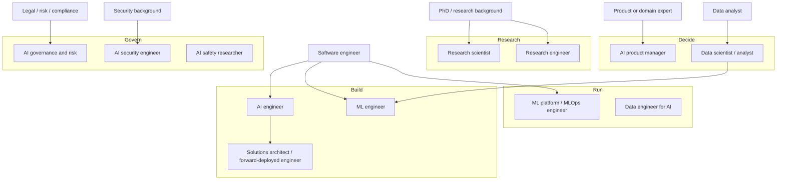

# AI Careers Map

**In one line:** AI work splits into roughly a dozen distinct roles across building, researching, running, deciding and governing; this map tells you what each one does day to day, what it needs, and the most realistic route in from where you are now.
**Last reviewed:** 2026-10-21

---

## The short version

- "Working in AI" covers very different jobs. An **AI engineer** builds products on top of models. An **ML engineer** trains and serves models. A **research scientist** invents new methods. A **governance lead** decides what is allowed. They need different skills.
- The fastest-growing group since 2023 has been **AI engineers** (also called applied AI or LLM engineers): software engineers who build with model APIs, retrieval, agents and evals. It is the most accessible route for people who already code.
- **Research roles** still mostly expect a PhD or an equivalent public research record. **ML engineering** expects solid software skills plus ML fundamentals.
- **Non-coding routes are real**: AI product manager, solutions architect, AI governance and risk, AI enablement and training, and domain experts who become the AI lead for their function.
- Pick a target role, build two or three public projects that look like that job, and learn in that order. Certificates help most for cloud and vendor-facing roles; see [AI certifications guide](../certifications/ai-certifications-guide.md).

## The map

## Role by role

### AI engineer (applied AI, LLM engineer)

- **What you do:** build features and products on foundation models: prompts, retrieval (RAG), tool use and agents, structured outputs, evaluation, and production operations. Choose models, control cost, and make things reliable.
- **Day to day:** writing Python or TypeScript; reading traces of bad answers; improving an eval set; shipping.
- **Core skills:** software engineering, APIs, [RAG](../../learn/concepts/rag-explained.md), [agents](../../learn/concepts/agents-explained.md), [evals](../../learn/concepts/evals-for-llms.md), [prompt engineering](../../learn/concepts/prompt-engineering.md), basic cloud.
- **Route in:** from software engineering, usually. Build three projects: a RAG app with an eval harness, an agent with tools, and an extraction pipeline.
- **Roadmap:** [AI engineer roadmap](ai-engineer-roadmap.md). **Interview prep:** [AI engineer interview](../interviews/ai-engineer-interview.md).

### ML engineer

- **What you do:** train, fine-tune, evaluate, optimise and serve models, including classical ML (recommendations, forecasting, fraud) and deep learning. Own pipelines from data to deployed model.
- **Core skills:** Python, PyTorch, ML fundamentals, data pipelines, model serving, MLOps, GPUs.
- **Route in:** from software engineering (learn ML fundamentals) or data science (learn production engineering).
- **Read:** [what is machine learning](../../learn/concepts/what-is-machine-learning.md), [ML engineer path](../../learn/start-here/ml-engineer-path.md). **Interview prep:** [ML engineer interview](../interviews/ml-engineer-interview.md).

### Research scientist

- **What you do:** invent and test new methods; publish; set research direction. At frontier labs this includes pre-training, post-training ([RLHF](../../papers/language-models/05-instructgpt-rlhf/summary.md), [RLVR](../../papers/techniques/39-rlvr/summary.md)), interpretability and evaluation.
- **Core skills:** deep maths and ML theory, experimental design, writing, a publication record.
- **Route in:** usually a PhD, or an outstanding public record (papers, open-source research code) without one.
- **Read:** [researcher path](../../learn/start-here/researcher-path.md) and the [reading roadmap](../../docs/ROADMAP.md).

### Research engineer

- **What you do:** make research run: large-scale training infrastructure, experiments, evaluation harnesses, performance work. Often the most in-demand role at labs.
- **Core skills:** strong engineering, distributed systems, GPU performance, enough ML to collaborate on research.
- **Route in:** from strong software or infrastructure engineering plus ML projects; reproducing papers publicly is a good signal. See [ZeRO and Megatron-LM](../../papers/techniques/76-zero-megatron/summary.md) and [FlashAttention](../../papers/techniques/16-flash-attention/summary.md) for the flavour of work.

### ML platform / MLOps engineer

- **What you do:** build the platform others use: training and serving infrastructure, feature stores, model registries, GPU clusters, LLM gateways, observability.
- **Core skills:** DevOps, Kubernetes, cloud, infrastructure as code, monitoring, cost control.
- **Route in:** from DevOps, SRE or platform engineering. See [LLMOps and observability](../../build/patterns/llmops-observability.md) and [LLM serving](../../tools/decisions/llm-serving.md).

### Data engineer for AI

- **What you do:** pipelines that feed models and retrieval: ingestion, cleaning, chunking and embedding, data quality, governance.
- **Route in:** from data engineering; add vector search and document processing. See [embeddings and vector search](../../learn/concepts/embeddings-and-vector-search.md).

### Data scientist

- **What you do:** analyse data, build and evaluate models, run experiments, and increasingly evaluate AI systems and measure their business impact.
- **Route in:** from analytics, statistics or science. Strong statistics plus Python and SQL.

### Solutions architect / forward-deployed engineer / AI consultant

- **What you do:** help customers or internal teams design and adopt AI systems; part engineer, part adviser. Vendors, cloud providers and consultancies hire many.
- **Core skills:** broad technical knowledge, architecture, communication, cloud. Vendor certifications are most useful here.
- **Route in:** from engineering, consulting or pre-sales. See [AI system design interview](../interviews/ai-system-design-interview.md).

### AI product manager

- **What you do:** decide what to build and how to measure it; understand model capabilities and limits well enough to set realistic scope; own evals as product quality.
- **Route in:** from product management (learn the technology hands-on) or from engineering. See [AI for leaders](../../learn/start-here/ai-for-leaders.md).

### AI security engineer

- **What you do:** threat-model AI systems, red-team them, secure agents and model supply chains.
- **Route in:** from application or cloud security. See [OWASP LLM Top 10](../../safety/security/owasp-llm-top-10.md) and the [prompt injection red team](../../build/projects/prompt-injection-red-team.md) project.

### AI governance, risk and compliance

- **What you do:** set policy, run risk assessments, map to regulation (EU AI Act, sector rules) and standards (ISO/IEC 42001, NIST AI RMF), and answer customer and regulator questions.
- **Route in:** from legal, privacy, risk, audit or compliance; learn enough of the technology to ask good questions. See [AI governance program](../../safety/governance/ai-governance-program.md).

### AI safety and alignment researcher

- **What you do:** research how to make advanced AI systems behave as intended: alignment, interpretability, evaluations of dangerous capabilities, oversight.
- **Route in:** research background, or strong engineering plus self-directed research. Read [weak-to-strong generalization](../../papers/techniques/128-weak-to-strong/summary.md), [sleeper agents](../../papers/techniques/83-sleeper-agents/summary.md), [circuit tracing](../../papers/techniques/151-circuit-tracing/summary.md) and [frontier safety frameworks](../../explainers/policy/frontier-safety-frameworks.md).

### AI enablement, training and "AI lead for X"

- **What you do:** help a team or function adopt AI well: training, playbooks, champions programs, measuring impact. Often a domain expert (sales, marketing, finance, support) who became the go-to person.
- **Route in:** be excellent at AI in your current job, then teach it. See [AI adoption playbook](../../work/enablement/ai-adoption-playbook.md) and [AI champions program](../../work/enablement/ai-champions-program.md).

## Choosing your target

| If you are... | Most realistic first AI role | First three steps |
|---|---|---|
| A software engineer | AI engineer | Build a RAG app with evals; build an agent; ship one AI feature at work |
| A DevOps or SRE engineer | ML platform / MLOps | Serve an open model with vLLM; add tracing and cost dashboards; learn GPU basics |
| A data analyst or scientist | Data scientist (AI-heavy) or ML engineer | Build an LLM eval; learn production Python; deploy a model |
| A PhD student in a related field | Research scientist or engineer | Publish; open-source your code; reproduce a recent paper |
| A security professional | AI security engineer | Red-team an LLM app; learn agent threat models; write up findings |
| In legal, risk or compliance | AI governance | Learn the EU AI Act and NIST AI RMF; run a risk assessment on a real system |
| A product manager | AI product manager | Build a prototype yourself; write an eval spec; ship one AI feature |
| A domain expert, non-technical | AI lead or enablement for your function | Master the tools for your job; document playbooks; train colleagues |

## Signals that get you hired

- **Public projects that look like the job.** A repository with a README, an eval table, and honest notes on what failed beats a certificate list.
- **Writing.** A short blog post explaining a project or a paper shows you understand it.
- **Shipping at your current job.** "I added an AI feature used by 400 people and cut handling time by X" is the strongest story there is.
- **Credentials where they matter.** Cloud and vendor certifications help most for solutions, consulting and platform roles. See the [certifications guide](../certifications/ai-certifications-guide.md).

## Common mistakes

- **Aiming at "AI" instead of a role.** Choose one target; it decides what to learn.
- **Collecting courses instead of building.** After the basics, projects teach more.
- **Skipping software fundamentals.** Most AI jobs are engineering jobs first.
- **Assuming a PhD is required for everything.** It is for most research scientist roles, not for most AI engineering roles.
- **Ignoring your existing expertise.** Domain knowledge plus AI skills is a strong, less crowded combination.

## Next steps

- [AI engineer roadmap](ai-engineer-roadmap.md)
- Interviews: [AI engineer](../interviews/ai-engineer-interview.md), [ML engineer](../interviews/ml-engineer-interview.md), [AI system design](../interviews/ai-system-design-interview.md)
- [AI certifications guide](../certifications/ai-certifications-guide.md)
- Start learning: [zero to hero path](../../learn/start-here/zero-to-hero-path.md), [AI engineer path](../../learn/start-here/ai-engineer-path.md), [ML engineer path](../../learn/start-here/ml-engineer-path.md)

## Sources

- Swyx (Shawn Wang), "The Rise of the AI Engineer" (2023), on the AI engineer role definition: https://www.latent.space/p/ai-engineer
- U.S. Bureau of Labor Statistics, Occupational Outlook Handbook: Computer and Information Research Scientists (education norms for research roles): https://www.bls.gov/ooh/computer-and-information-technology/computer-and-information-research-scientists.htm
- Chip Huyen, *AI Engineering* (O'Reilly, 2025), on the scope of AI engineering vs ML engineering: https://www.oreilly.com/library/view/ai-engineering/9781098166298/
