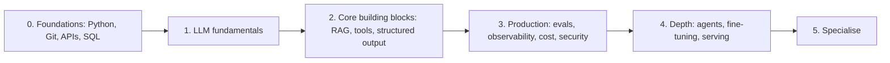

# AI Engineer Roadmap

**In one line:** A phase-by-phase plan (roughly 6 to 18 months part-time, depending on where you start) from programming foundations to shipping production LLM systems, with what to learn, what to build, and which certifications are worth it at each stage.
**Last reviewed:** 2026-10-21

---

## The short version

- An **AI engineer** builds products on foundation models: prompts, retrieval, tools and agents, evaluation, and production operations. The role is defined in the [AI careers map](ai-careers-map.md).
- The roadmap has six phases: **foundations, LLM fundamentals, core building blocks, production, depth, specialisation**. Each phase ends with a project you can show.
- If you already work as a software engineer, you can skip most of phase 0 and reach phase 3 in a few months of evenings.
- **Projects beat certificates** for this role. Certifications help in phases 3 to 5 if you work with a specific cloud or vendor, or want to move into solutions or consulting work.
- Re-check the certification picks before you book: several popular AI exams were **retired in 2026** (noted below).

## The phases at a glance

| Phase | Time (part-time) | You can show |
|---|---|---|
| 0. Foundations | 0-3 months | A small Python web API on GitHub |
| 1. LLM fundamentals | 2-4 weeks | A chatbot with streaming and a cost meter |
| 2. Core building blocks | 1-2 months | A RAG app and an extraction pipeline |
| 3. Production | 1-2 months | An eval harness in CI, traces, a red-team report |
| 4. Depth | 2-3 months | An agent with MCP tools; a LoRA fine-tune; a self-hosted model |
| 5. Specialise | Ongoing | A substantial project in your chosen niche |

## Phase 0: foundations (0-3 months, skip what you know)

**Learn**
- Python: functions, classes, packages, virtual environments, async basics. See [Python for AI](../../learn/day-one/python-for-ai.md).
- Git and GitHub; the command line.
- HTTP APIs and JSON; build and call a REST API (FastAPI is a good choice).
- SQL basics.
- Enough maths to read diagrams and papers: vectors, dot products, probability basics. You do not need calculus to start building.
- Cloud basics on one provider.

**Optional certification:** a cloud fundamentals exam if you are new to cloud, for example [AWS Cloud Practitioner](https://cloud.noblerworks.com/exams/aws/foundational/cloud-practitioner-clf-c02/) or [Google Cloud Digital Leader](https://cloud.noblerworks.com/exams/gcp/cloud-digital-leader/).

**Build:** a small web API that stores and returns data, deployed somewhere public.

## Phase 1: LLM fundamentals (2-4 weeks)

**Learn**
- What an LLM is and is not: [LLM basics](../../learn/concepts/llm-basics.md), [tokenization](../../explainers/concepts/tokenization.md), [sampling and decoding](../../explainers/concepts/sampling-and-decoding.md), [context windows](../../explainers/concepts/context-windows.md).
- How transformers work at a high level: [transformer architecture](../../learn/concepts/transformer-architecture.md) and the original [Attention Is All You Need](../../papers/architectures/01-attention-is-all-you-need/summary.md).
- How chat models are trained: [InstructGPT / RLHF](../../papers/language-models/05-instructgpt-rlhf/summary.md), and [reasoning models](../../explainers/concepts/reasoning-models.md).
- Calling APIs: [first LLM API call](../../learn/day-one/first-llm-api-call.md), [API keys and env vars](../../learn/day-one/api-keys-and-env-vars.md).
- [Prompt engineering](../../learn/concepts/prompt-engineering.md) and [hallucinations](../../learn/concepts/hallucinations.md).
- Running a model locally: [run a model locally](../../learn/day-one/run-a-model-locally.md).

**Optional certification:** [NVIDIA Generative AI LLMs Associate (NCA-GENL)](https://cloud.noblerworks.com/exams/nvidia/genai-llms-associate/) or [AWS AI Practitioner (AIF-C01)](https://cloud.noblerworks.com/exams/aws/foundational/ai-practitioner-aif-c01/) to structure your study. Both are foundational.

**Build:** [chatbot in an afternoon](../../build/projects/chatbot-in-an-afternoon.md).

## Phase 2: core building blocks (1-2 months)

**Learn**
- [Embeddings and vector search](../../learn/concepts/embeddings-and-vector-search.md) and [RAG](../../learn/concepts/rag-explained.md); the [RAG paper](../../papers/techniques/13-rag/summary.md).
- [Structured outputs](../../learn/concepts/structured-outputs.md).
- [Tool use and function calling](../../learn/concepts/tool-use-and-function-calling.md); the [ReAct](../../papers/techniques/21-react/summary.md) and [Toolformer](../../papers/techniques/24-toolformer/summary.md) papers.
- [Prompt caching](../../learn/concepts/prompt-caching.md) and [context window management](../../learn/concepts/context-windows-and-management.md).
- [Fine-tuning vs RAG](../../learn/concepts/fine-tuning-vs-rag.md): when each applies.
- [Multimodal models](../../learn/concepts/multimodal-models.md): images and PDFs as input.

**Build:** [build a RAG pipeline](../../build/projects/build-rag-pipeline.md) and [structured extraction pipeline](../../build/projects/structured-extraction-pipeline.md).

## Phase 3: production (1-2 months)

This phase is what separates demo builders from people companies trust with production systems.

**Learn**
- [Evals for LLMs](../../learn/concepts/evals-for-llms.md) and [LLM-as-a-judge](../../papers/techniques/85-llm-as-judge/summary.md).
- [LLM app architecture](../../build/patterns/llm-app-architecture.md): gateways, fallbacks, guardrails.
- [LLMOps and observability](../../build/patterns/llmops-observability.md): tracing, metrics, release practices.
- [Cost and latency control](../../build/patterns/cost-and-latency-control.md).
- Security: [OWASP LLM Top 10](../../safety/security/owasp-llm-top-10.md), [prompt injection explained](../../safety/security/prompt-injection-explained.md), [guardrails and safety](../../learn/concepts/guardrails-and-safety.md).
- Responsible AI: [responsible AI basics](../../safety/governance/responsible-ai-basics.md).

**Build:** [set up an eval harness](../../build/projects/set-up-eval-harness.md) wired into CI for your phase 2 project, and the [prompt injection red team](../../build/projects/prompt-injection-red-team.md) against it. Write up the results.

**Certifications worth considering here (pick by your stack):**
- Claude: [Claude Certified Developer - Foundations (CCDV-F)](https://cloud.noblerworks.com/exams/anthropic/claude-certified-developer-foundations/) or [Claude Certified Architect - Foundations (CCAR-F)](https://cloud.noblerworks.com/exams/anthropic/claude-certified-architect-foundations/).
- Databricks: [Generative AI Engineer Associate](https://cloud.noblerworks.com/exams/databricks/genai-engineer-associate/).
- Oracle: [OCI Generative AI Professional](https://cloud.noblerworks.com/exams/oracle/oci-generative-ai-professional/).

## Phase 4: depth (2-3 months)

**Learn**
- [Agents explained](../../learn/concepts/agents-explained.md), [agentic loops](../../learn/concepts/agentic-loops.md), [agent architectures](../../build/patterns/agent-architectures.md), [MCP](../../learn/concepts/mcp-explained.md), [agent security](../../safety/security/agent-security.md).
- [Advanced RAG patterns](../../build/patterns/advanced-rag-patterns.md).
- Fine-tuning: [LoRA](../../papers/techniques/10-lora/summary.md), [QLoRA](../../papers/techniques/22-qlora/summary.md), [DPO](../../papers/language-models/19-dpo/summary.md).
- Serving: [inference servers](../../learn/concepts/inference-servers.md), [quantization and distillation](../../learn/concepts/quantization-and-distillation.md), [GPUs for AI](../../learn/concepts/gpus-for-ai.md), [PagedAttention / vLLM](../../papers/techniques/52-pagedattention-vllm/summary.md).

**Build:** [build a Claude agent with MCP](../../build/projects/build-claude-agent-with-mcp.md), [fine-tune with LoRA](../../build/projects/fine-tune-with-lora.md), [run Llama on a single GPU](../../build/projects/run-llama-on-single-gpu.md).

**Certifications worth considering here:**
- AWS: [Generative AI Developer - Professional (AIP-C01)](https://cloud.noblerworks.com/exams/aws/professional/genai-developer-aip-c01/).
- NVIDIA: [Agentic AI Professional (NCP-AAI)](https://cloud.noblerworks.com/exams/nvidia/agentic-ai-professional/) or [Generative AI LLMs Professional (NCP-GENL)](https://cloud.noblerworks.com/exams/nvidia/genai-llms-professional/).
- Google Cloud: [Professional Machine Learning Engineer](https://cloud.noblerworks.com/exams/gcp/machine-learning-engineer/).
- Claude: [Claude Certified Architect - Professional (CCAR-P)](https://cloud.noblerworks.com/exams/anthropic/claude-certified-architect-professional/).

## Phase 5: specialise (ongoing)

Pick one direction and go deep:

| Direction | Focus | Next reading |
|---|---|---|
| Agents and automation | Long-running agents, computer use, evaluation of agents | [Agent benchmarks](../../explainers/benchmarks/agents-and-computer-use.md), [METR time horizons](../../papers/techniques/145-metr-time-horizons/summary.md) |
| Search and knowledge | Retrieval quality, GraphRAG, enterprise search | [GraphRAG](../../papers/techniques/60-graph-rag/summary.md), [dense retrieval](../../papers/techniques/87-dense-retrieval/summary.md) |
| Model customisation | Fine-tuning, distillation, post-training | [Tulu 3](../../papers/language-models/148-tulu-3/summary.md), [knowledge distillation](../../papers/techniques/134-knowledge-distillation/summary.md) |
| Inference and infrastructure | Serving at scale, GPU efficiency | [LLM serving](../../tools/decisions/llm-serving.md), [inference economics](../../explainers/compute/inference-economics.md) |
| AI security | Red teaming, agent security | [LLM red teaming](../../safety/security/llm-red-teaming.md), [AI threat modeling](../../safety/security/ai-threat-modeling.md) |
| Voice and multimodal | Realtime voice, vision, documents | [Voice agent](../../build/projects/voice-agent.md), [multimodal models](../../learn/concepts/multimodal-models.md) |

## Certification notes (as of 2026-10)

Several certifications that older roadmaps recommend are no longer available:

- **AWS Machine Learning - Specialty (MLS-C01)**: retired April 2025.
- **AWS Machine Learning Engineer - Associate (MLA-C01)**: retired 28 September 2026; a successor, MLA-C02, was in beta with no general availability date announced.
- **Microsoft Azure AI Fundamentals (AI-900)** and **Azure AI Engineer Associate (AI-102)**: retired 30 June 2026. **Azure Data Scientist Associate (DP-100)**: retired 1 June 2026.

For everything still available, prices and levels, see the [AI certifications guide](../certifications/ai-certifications-guide.md).

## Career progression

| Stage | Typical scope |
|---|---|
| Junior / early career | Builds features with guidance; owns prompts and tests for one feature |
| Mid-level | Owns an AI feature end to end: design, evals, launch, monitoring |
| Senior | Designs systems across features; sets eval and release standards; mentors |
| Staff / principal | Sets AI architecture and platform direction across an organisation |

Pay varies widely by country, company and level; use current salary-survey data for your market rather than any single figure.

## How to show your work

For each project: a public repository, a README with the problem, architecture diagram, an **eval table** (what you measured, the numbers, what failed), cost per task, and what you would do next. Link them from your CV. Interviewers will ask about trade-offs; see [AI engineer interview](../interviews/ai-engineer-interview.md) and [AI system design interview](../interviews/ai-system-design-interview.md).

## Common mistakes

- **Tutorial loops.** After phase 1, every week should produce something you built.
- **Skipping evals.** It is the skill that most separates candidates.
- **Framework-first learning.** Learn the raw API loop before adopting a framework, so you can debug it.
- **Collecting every certificate.** One or two aligned with your stack is plenty.
- **Ignoring security.** Agents with tools are attack surfaces; employers know it.

## Next steps

- [AI careers map](ai-careers-map.md) if you are still choosing a role
- [AI engineer path](../../learn/start-here/ai-engineer-path.md) for the learning sequence in more detail
- [AI certifications guide](../certifications/ai-certifications-guide.md)
- Sibling site's full roadmap (with cloud certification detail): [AI/ML engineer roadmap on Zero to Hero](https://cloud.noblerworks.com/resources/certification-roadmap-ai-ml-engineer/)

## Sources

- Zero to Hero, AI/ML Engineer Roadmap (phases, role definition, skills; used as raw material): https://cloud.noblerworks.com/resources/certification-roadmap-ai-ml-engineer/
- AWS, Machine Learning Engineer - Associate (MLA-C01 retirement, MLA-C02 beta): https://aws.amazon.com/certification/certified-machine-learning-engineer-associate/
- Microsoft Learn, retired certification exams (AI-900, AI-102, DP-100): https://learn.microsoft.com/en-us/credentials/support/retired-certification-exams
- Anthropic certification program (via the Zero to Hero Anthropic index; Pearson VUE delivery, launched March 2026): https://cloud.noblerworks.com/exams/anthropic/
