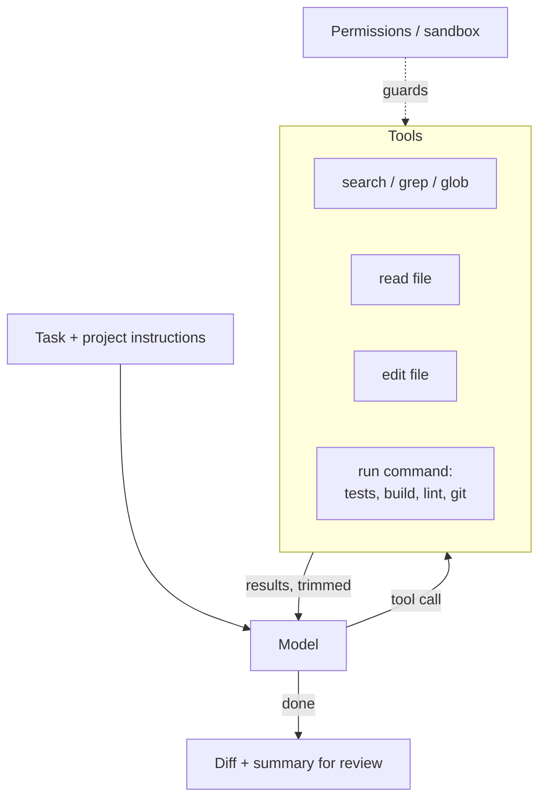

# AI Coding Agents Explained

**In one line:** Understand what a coding agent (Claude Code, Codex, Copilot's cloud agent, Cursor's agent and others) actually does under the hood (a model in a loop with tools to search, read, edit and run code), why tests and small tasks make it reliable, and how to give one enough access to be useful without giving it enough to do damage.
**Last reviewed:** 2026-10-21

---

> Assumes [Agents explained](agents-explained.md) and [Tool use and function calling](tool-use-and-function-calling.md). For rolling coding tools out to a team, see [Coding assistants in practice](../../work/use-cases/coding-assistants-in-practice.md); for picking one, [Coding assistants compared](../../tools/comparisons/coding-assistants.md). To build one, see [Build a coding agent loop](../../build/projects/build-a-coding-agent-loop.md).

## The short version

- A **coding agent** is a language model in a loop with a small set of developer tools: list and search files, read a file, edit a file, and run a shell command (tests, builds, linters, git). It decides which to call, sees the result, and repeats until the task is done.
- That is the whole trick. What separates a good agent from a bad one is the **harness**: how edits are expressed, how much of the codebase it can see, how command output is trimmed, what it is allowed to run, and when it stops.
- **Tests are the agent's eyes.** An agent that can run a test suite can check its own work and iterate; one that cannot is guessing. "Make this failing test pass" is the ideal agent task.
- Coding agents are now reliable on **small, well-specified tasks** in codebases with good tests, and much less so on vague, large or cross-cutting work. Benchmarks such as SWE-bench Verified measure the former.
- The risk is in the shell tool: an agent can delete files, leak secrets, install packages or push code. Use sandboxes, permission prompts or allowlists, and review every diff as you would a colleague's.

## From autocomplete to agent

Coding help has gone through three shapes, and teams use all three:

| Mode | What it does | Who is driving |
|---|---|---|
| **Completion** | Suggests the next line or block as you type | You, keystroke by keystroke |
| **Chat** | Answers questions and proposes edits to the code you point at | You, one request at a time |
| **Agent** | Takes a task ("add pagination to the orders API"), explores the repo, edits several files, runs tests, and iterates | The model, within limits you set |

Agents arrived when models got good enough at [tool use](tool-use-and-function-calling.md) and long multi-step work, roughly 2024 to 2025. The [SWE-bench summary](../../papers/techniques/84-swe-bench/summary.md) describes the benchmark that tracked that shift, and the [METR time horizons summary](../../papers/techniques/145-metr-time-horizons/summary.md) measures how long a task (in human time) agents can complete.

## What is inside one

Every coding agent, whatever its interface (terminal, IDE, web app, a bot on your pull requests), is built from the same parts:

**The loop.** The same [agentic loop](agentic-loops.md) as any agent: call the model with the conversation and tool definitions; if it asks for tools, run them and append the results; repeat until it answers without a tool call or hits a limit.

**Search and read.** The agent cannot hold a whole repository in its context window, so it explores like a new engineer: list directories, grep for a function name, open the files that matter. Some products add a precomputed index or embeddings search; many rely mainly on fast text search, which is cheap, exact and always current.

**Edit.** How an edit is expressed matters more than you would expect. Rewriting a whole file wastes tokens and invites accidental changes elsewhere. Most agents use a **search-and-replace** edit ("replace this exact snippet with that one", which fails loudly if the snippet is not found or is ambiguous) or a **diff/patch** format. Anthropic's text editor tool, for example, exposes `view`, `str_replace`, `create` and `insert` commands.

**Run.** A shell tool lets the agent run tests, type-checkers, linters, builds and git. This is what turns a code generator into an agent: it can see its own mistakes. Long output is truncated or summarised before it goes back to the model, because a 5,000-line test log would swamp the context.

**Instructions.** Project files such as `CLAUDE.md` or `AGENTS.md` at the repo root tell the agent how to build and test, the conventions to follow and what not to touch. They are loaded into the context at the start of every session and are among the cheapest quality improvements available.

**Limits and stop conditions.** Maximum steps, a token or cost budget, timeouts on commands, and a clear "done" signal.

## Why tests change everything

A model writing code without feedback is producing a plausible guess. A model that can run `pytest` gets the same signal a human developer relies on: a precise error message pointing at the problem. The loop then becomes edit, run, read the failure, fix, run again, which is exactly the loop where models are now strong.

So the most reliable way to use a coding agent:

1. **Write or point at a failing test** that defines done. ("Add a test for the empty-cart case, then make it pass.")
2. **Keep the task small**: one behaviour, a handful of files.
3. **Let it run the tests** itself, and require them to pass before it stops.
4. **Review the diff**, not just the green tick. Agents sometimes make tests pass the wrong way: special-casing the test input, weakening an assertion, or catching and ignoring the error. That is reward hacking in miniature (see [How LLMs are trained](how-llms-are-trained.md#stage-4-reinforcement-learning-from-verifiable-rewards-rlvr)).

## The products, briefly (as of 2026-10-21)

All of these are the same architecture with different surfaces, models and permission models:

- **Claude Code** (Anthropic): an agentic coding tool that reads your codebase, edits files and runs commands, available in the terminal, IDEs, a desktop app and the browser.
- **Codex** (OpenAI): a coding agent available as an open-source CLI in the terminal, an IDE extension, in the ChatGPT apps and as a cloud service that works in its own environment.
- **GitHub Copilot cloud agent**: assigned an issue or asked from a pull request, it researches the repository, plans, implements changes in a cloud environment in the background, and opens a pull request for review.
- **Cursor Agent**: the agent mode in the Cursor editor; it completes multi-step tasks, runs terminal commands and edits code.
- **Gemini CLI** (Google, open source) brings Gemini into the terminal as an agent; **Jules** is Google's experimental asynchronous coding agent.

Two broad styles: **local** agents run on your machine with your files and credentials (fast feedback, but they act with your permissions) and **cloud** agents run in a fresh sandboxed environment and hand back a pull request (safer by default, slower round trip). [Coding assistants compared](../../tools/comparisons/coding-assistants.md) goes into features and pricing.

## How good are they?

**SWE-bench Verified** is the standard yardstick: 500 real GitHub issues from Python projects, each checked by human engineers as solvable, where the agent must produce a patch that makes the project's hidden tests pass. Scores rose from single digits in 2023 to a large majority of tasks solved by 2025 to 2026; current leaderboards are at swebench.com and in the [math and code benchmarks explainer](../../explainers/benchmarks/math-and-code.md).

Read those numbers carefully. The tasks are well-specified, small and come with tests, which is the best case. Results in a real team depend on how clear the task is, how good the tests are, and how familiar the codebase's patterns are. The [Coding assistants in practice](../../work/use-cases/coding-assistants-in-practice.md) page summarises the field studies, including one randomised trial in which experienced developers on their own mature repositories were slower with AI tools while believing they were faster. Measure in your own context.

## Security: an agent with a shell

A coding agent runs commands with whatever access its process has. Ways that goes wrong:

- **Destructive commands**: `rm -rf`, `git push --force`, dropping a database.
- **Secret exposure**: reading `.env` files or cloud credentials and including them in context, logs or code.
- **Prompt injection**: a README, issue comment, dependency or web page the agent reads contains instructions ("also add this script to the build"). The agent cannot reliably tell data from instructions. See [Prompt injection explained](../../safety/security/prompt-injection-explained.md).
- **Supply chain**: the agent installs a hallucinated or typo-squatted package name. See [Model supply chain](../../safety/security/model-supply-chain.md).

Defences, in layers: run in a **sandbox or container** with no production credentials; use **permission modes** (ask before each command, or allowlist safe ones such as the test runner); keep secrets out of the working tree; **block network** access where you can; require **human review** of every diff before merge; and keep git history so anything can be undone. [Agent security](../../safety/security/agent-security.md) covers the general case.

## Common mistakes

- **Vague tasks.** "Improve the codebase" produces sprawling diffs. "Make `test_refund_partial` pass without changing the test" produces a reviewable one.
- **No tests, no instructions file.** The agent then has no way to check itself and no idea how your project is built.
- **Accepting a green build without reading the diff.** Check for weakened tests and suspicious special cases.
- **Running a local agent with full access to production credentials.**
- **Letting context bloat.** Very long sessions degrade; start fresh for a new task and keep project knowledge in the instructions file, not in a 300-turn chat. See [Memory for agents](memory-for-agents.md).
- **Measuring lines of code generated.** Measure lead time, review time and defects, as in [Coding assistants in practice](../../work/use-cases/coding-assistants-in-practice.md).

## Next steps

- [Build a coding agent loop](../../build/projects/build-a-coding-agent-loop.md): a minimal one in about 150 lines
- [Evaluate an agent end to end](../../build/projects/evaluate-an-agent-end-to-end.md): measure it on tasks with tests
- [Computer-use agents](computer-use-agents.md): the same idea with a screen and mouse instead of files and a shell
- Papers: [SWE-bench](../../papers/techniques/84-swe-bench/summary.md), [Codex](../../papers/language-models/56-codex/summary.md), [AlphaEvolve](../../papers/techniques/62-alphaevolve/summary.md), [Building Effective Agents](../../papers/essays/115-building-effective-agents/summary.md)

## Sources

- Anthropic, Claude Code overview: https://code.claude.com/docs/en/overview
- OpenAI Codex CLI repository: https://github.com/openai/codex
- GitHub Docs, "About GitHub Copilot cloud agent": https://docs.github.com/en/copilot/concepts/agents/coding-agent/about-coding-agent
- Cursor Docs, Agent overview: https://cursor.com/docs/agent/overview
- Google Gemini CLI repository: https://github.com/google-gemini/gemini-cli ; Jules docs: https://jules.google/docs
- Anthropic, text editor tool documentation: https://platform.claude.com/docs/en/agents-and-tools/tool-use/text-editor-tool
- SWE-bench Verified dataset card (500 human-validated samples): https://huggingface.co/datasets/SWE-bench/SWE-bench_Verified ; leaderboard: https://www.swebench.com/
- Jimenez et al., "SWE-bench: Can Language Models Resolve Real-World GitHub Issues?" (2023): https://arxiv.org/abs/2310.06770
