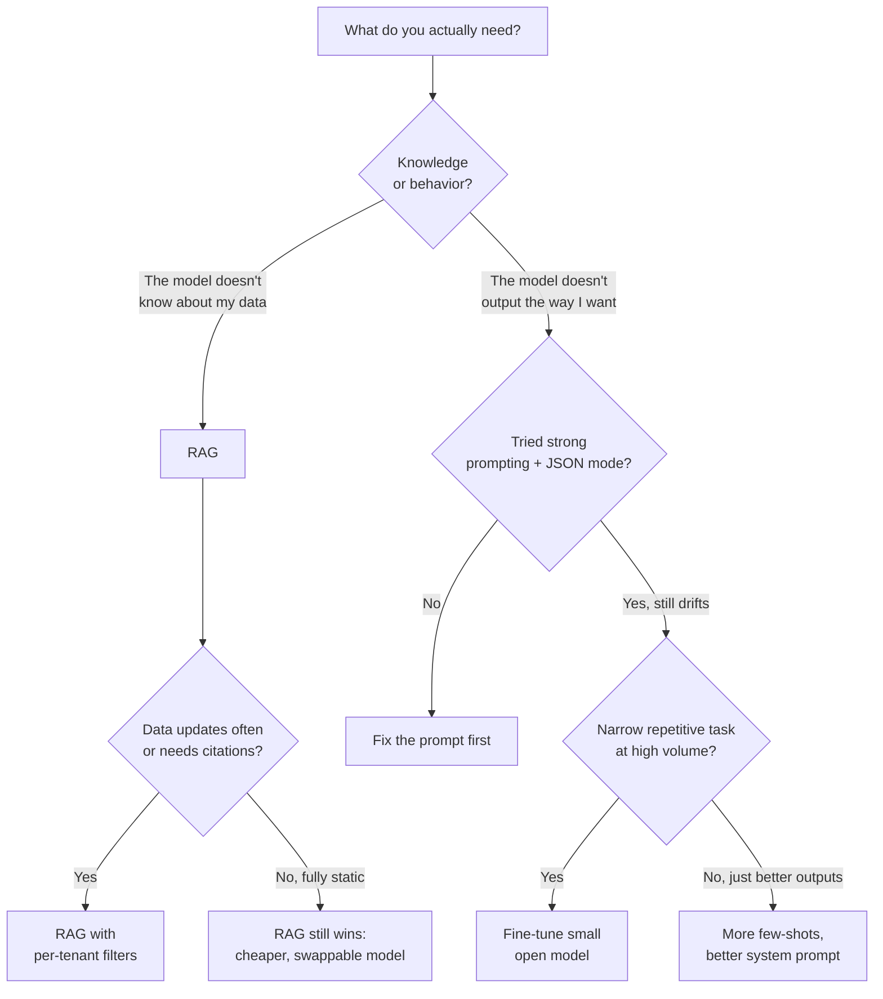

# Fine-Tuning vs RAG

**In one line:** Decide between fine-tuning (change how the model behaves) and RAG (change what it knows), and default to RAG unless you can say why not.
**Last reviewed:** 2026-10-21

---

## The one-line answer

[**Fine-tuning**](../../docs/GLOSSARY.md#fine-tuning) changes how the model behaves by retraining it on your examples. [**RAG**](../../docs/GLOSSARY.md#rag-retrieval-augmented-generation) changes what the model knows by giving it your data at query time. They solve different problems. Most teams reach for fine-tuning when they should reach for RAG.

## The default answer for most teams: RAG

If you can't articulate clearly why fine-tuning beats RAG for your specific case, the answer is RAG. Reasons:

- RAG is cheaper (pennies vs. thousands of dollars per fine-tune).
- RAG updates instantly when your data changes (fine-tunes are frozen).
- RAG can cite sources (fine-tunes blend everything).
- RAG doesn't lock you to a model version (fine-tuned weights live on a specific base model).
- RAG works with frontier models (you can use Claude Opus / GPT-4 with RAG; you generally fine-tune smaller open models).

Fine-tuning isn't bad. It's just frequently the wrong tool because people confuse "the model doesn't know X" (a knowledge problem - fix with RAG) with "the model doesn't behave the way I want" (a behavior problem - fix with fine-tuning, or with a better prompt).

## The decision tree

## The decision matrix

| You want to... | Use |
|----------------|-----|
| Give the model access to your docs / database / wiki | [**RAG**](../../docs/GLOSSARY.md#rag-retrieval-augmented-generation) |
| Make answers reflect data that updates daily | **RAG** |
| Cite sources / show provenance | **RAG** |
| Multi-tenant: each tenant has different data | **RAG** with metadata filters |
| Force a specific output format the model keeps drifting on | **Fine-tune** (or stronger prompting + JSON mode first) |
| Match a brand voice across all outputs | **Fine-tune** (or strong system prompt first) |
| Reduce token count by burning standing instructions into the model | **Fine-tune** |
| Improve accuracy on a narrow, repetitive task at scale | **Fine-tune** small open model + run cheap |
| Make a smaller / cheaper model behave like a larger one for a specific task | **Fine-tune** (distillation) |
| Refuse certain content reliably | **Fine-tune** (or constitutional AI / system prompt + eval) |

## When fine-tuning genuinely wins

There are real cases. Don't dismiss it:

### Narrow repetitive tasks at scale
You're classifying 10M support tickets per day into 50 categories. A fine-tuned 7B open model running on your own GPUs is dramatically cheaper than calling GPT-4 or Claude. RAG doesn't help here - the task isn't knowledge-bound.

### Format adherence the prompt can't lock down
You need outputs in a very specific schema, with very specific fields, no exceptions, every time. Fine-tuning on 1000 examples of the format makes it second nature in a way prompts struggle to.

### Brand / voice consistency
You want the model to write in a very particular tone across thousands of pieces of content. Few-shot examples help; fine-tuning helps more.

### Reducing token bloat
Your system prompt is 4000 tokens of instructions you reuse every call. Fine-tune those instructions in - now your context is smaller, faster, cheaper per request.

### Distillation
You have a frontier model doing a task well at $0.05 per call. Generate 50K labeled examples with it, fine-tune a 7B model, run that for $0.001 per call.

## Fine-tuning, briefly

The recipe:

1. Collect (input, ideal output) examples. 100 minimum, 1000+ for serious gains.
2. Pick a base model that supports fine-tuning (`gpt-4o-mini`, OpenAI; Claude fine-tuning has been limited (as of 2025 it was offered only for some models through Amazon Bedrock), so check current availability; or any open model: Llama, Qwen, Mistral).
3. Run the fine-tune (managed API or your own infra with [LoRA](../../papers/techniques/10-lora/summary.md)/QLoRA).
4. Evaluate: measure on a held-out set against the base model. If you don't measure, you don't know it helped.
5. Deploy. Pin the version - re-fine-tune when base or data changes.

Cost varies wildly. OpenAI fine-tunes: tens to hundreds of dollars depending on dataset size. Self-hosted on a rented GPU: $5-100 for a small adapter. Full pre-training: not happening for you.

## Hybrid: RAG + fine-tune

The strongest production setups often combine both:

- Fine-tune to lock down format, tone, and how the model uses retrieved context.
- RAG to inject the actual current information.

Example: a support bot fine-tuned to always follow the company's reply template, escalate certain types of issues, and never recommend competitors - then RAG provides the actual product details from a constantly-updated knowledge base.

## When to revisit your choice

- "RAG isn't accurate enough" → before fine-tuning, audit retrieval quality. Bad retrieval looks like a model problem and isn't. Fix chunking, add reranking.
- "Fine-tuning didn't help" → check your eval set. You may not have enough examples, or your examples are inconsistent.
- "We're paying too much for inference" → is fine-tuning a smaller model an option? Frequently yes.

## Next steps

- **[RAG explained](rag-explained.md)** - the deep dive on the more common path
- **[LLM basics](llm-basics.md)** - context for both approaches
- **[Evals for LLMs](evals-for-llms.md)** - you need these regardless of which path you choose
- **[NVIDIA AI Operations cert](https://cloud.noblerworks.com/exams/nvidia/)** - covers production fine-tuning and serving

In the research library:

- [LoRA](../../papers/techniques/10-lora/summary.md) - the cheap way most fine-tuning is done today
- [QLoRA](../../papers/techniques/22-qlora/summary.md) - fine-tuning on a single GPU
- [RAG (the 2020 paper)](../../papers/techniques/13-rag/summary.md) - the retrieval side
- [FLAN](../../papers/techniques/80-flan/summary.md) - instruction tuning, the fine-tune behind chat models
- [DPO](../../papers/language-models/19-dpo/summary.md) - preference tuning without RL
- [Knowledge distillation](../../papers/techniques/134-knowledge-distillation/summary.md) - the "big model teaches small model" pattern
- [Fine-tune with LoRA](../../build/projects/fine-tune-with-lora.md) - hands-on project

## Sources

- OpenAI, fine-tuning guide: https://platform.openai.com/docs/guides/fine-tuning
- Anthropic, "Fine-tune Claude 3 Haiku in Amazon Bedrock" (2024): https://www.anthropic.com/news/fine-tune-claude-3-haiku
- Hu et al., "LoRA" (2021): https://arxiv.org/abs/2106.09685
