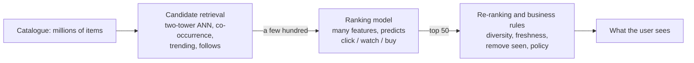

# Recommender Systems Basics

**In one line:** Understand how "you might also like" works (content-based filtering, collaborative filtering, embeddings, and the two-stage retrieve-then-rank design), build a tiny recommender in 30 lines, and know the traps (cold start, popularity bias, feedback loops) before you build one for real.
**Last reviewed:** 2026-10-21

---

> Assumes [Classic ML: supervised vs unsupervised](classic-ml-supervised-vs-unsupervised.md) and [Embeddings and vector search](embeddings-and-vector-search.md).

## The short version

- A recommender ranks items (products, videos, articles, jobs) for a person in a context. It is probably the most commercially important kind of ML: it decides most of what you see on shopping sites, streaming services and social feeds.
- **Content-based filtering** recommends items similar to ones you liked, using the items' own attributes ("other sci-fi films"). **Collaborative filtering** recommends what people with similar behaviour liked, using only the interaction data ("people who watched this also watched").
- Modern systems learn an **embedding** for every user and every item so that a good match means vectors that point the same way. Matrix factorisation was the classic version; two-tower neural networks are the current one.
- At scale, every serious system has **two stages**: a cheap **candidate retrieval** step that pulls a few hundred items out of millions, then an expensive **ranking** model that scores those few hundred carefully.
- The hard problems are not the algorithm: **cold start** (new users and items have no history), **implicit feedback** (a click is not a "like"), **popularity bias** and **feedback loops** (you only learn about what you already showed), and choosing what to optimise.

## The problem in one picture

Recommendation data is a giant, mostly empty table: users down the side, items across the top, and a mark where a user interacted with an item.

```
               Alien  Aliens  Blade Runner  Notting Hill  Love Actually  Mamma Mia!
ana              5      4         5             .             1             .
ben              4      5         4             1             .             1
cho              .      5         4             .             .             1
dev              1      .         1             5             4             5
eli              .      1         .             4             5             4
fay              5      .         .             .             2             .
```

The task is to fill in the dots: predict which empty cells a user would rate highly, then show the top few. Real tables have millions of rows and columns and are more than 99% empty.

The marks come in two kinds. **Explicit feedback** is a deliberate rating (stars, thumbs). It is clean but rare. **Implicit feedback** is behaviour: clicks, watch time, purchases, skips. It is plentiful but noisy (you clicked by accident, or watched a bad film to the end) and has no true negatives (not clicking might mean "not interested" or "never saw it"). Most production systems run on implicit feedback.

## Content-based filtering

Describe each item with features: genre, director, price band, the text of its description, or an embedding of that text or of its image. Build a profile of the user from the items they engaged with, and recommend the nearest unseen items.

Strengths: it works for a brand new item on day one (it has attributes even with no history), and its reasons are explainable ("because you watched Alien"). Weaknesses: it can only recommend more of the same, it never surprises, and it is only as good as the item features. Text and image embeddings have made it much stronger, because "similar" can now mean similar in meaning rather than sharing a tag.

## Collaborative filtering

Ignore item attributes entirely and use the pattern of who interacted with what. Two flavours:

- **User-user:** find users whose history resembles yours, recommend what they liked.
- **Item-item:** two items are similar if the same people rate them alike; recommend items similar to those you liked. Amazon published this approach in 2003 because item similarities are more stable than user similarities and can be precomputed.

Here is item-item collaborative filtering on the table above, in plain NumPy:

```python
import numpy as np

items = ["Alien", "Aliens", "Blade Runner", "Notting Hill", "Love Actually", "Mamma Mia!"]
# rows = users, columns = items; 1-5 stars, 0 = not rated
R = np.array([
    [5, 4, 5, 0, 1, 0],   # ana
    [4, 5, 4, 1, 0, 1],   # ben
    [0, 5, 4, 0, 0, 1],   # cho
    [1, 0, 1, 5, 4, 5],   # dev
    [0, 1, 0, 4, 5, 4],   # eli
    [5, 0, 0, 0, 2, 0],   # fay: liked Alien, little else rated
], dtype=float)

# Item-item similarity: subtract each user's average so "generous raters" don't dominate,
# then take the cosine between item columns
mask = R > 0
centred = np.where(mask, R - R.sum(1, keepdims=True) / mask.sum(1, keepdims=True), 0)
norms = np.linalg.norm(centred, axis=0)
sim = (centred.T @ centred) / np.outer(norms, norms)
np.fill_diagonal(sim, 0)

def recommend(user, k=2):
    rated = mask[user]
    scores = {}
    for j in np.where(~rated)[0]:
        w = np.clip(sim[j, rated], 0, None)   # learn only from positively similar items
        if w.sum() == 0:
            continue
        scores[items[j]] = float(w @ R[user, rated] / w.sum())
    return sorted(scores.items(), key=lambda kv: -kv[1])[:k]

print("most similar to Alien:", items[int(sim[0].argmax())])
print("for fay:", [(t, round(s, 1)) for t, s in recommend(5)])
print("for cho:", [(t, round(s, 1)) for t, s in recommend(2)])
```

```
most similar to Alien: Blade Runner
for fay: [('Aliens', 5.0), ('Blade Runner', 5.0)]
for cho: [('Alien', 4.2), ('Notting Hill', 1.0)]
```

Nobody told the code that Alien and Blade Runner are both science fiction. It discovered that from who rated what. Fay rated Alien highly, so she gets its neighbours. Cho's second "recommendation" has a predicted rating of 1.0: the system correctly expects her to dislike it, which is why real systems threshold or rank on the score and never just fill a slot.

The weakness shows in the same table: a film nobody has rated yet has an empty column and cannot be recommended at all. That is the **cold start** problem, and it is why production systems blend collaborative and content signals.

## Embeddings and matrix factorisation

The approach that won the Netflix Prize (2006 to 2009) was **matrix factorisation**: learn a short vector (say 50 numbers) for every user and every item so that the dot product of a user's vector and an item's vector approximates the rating. Training only uses the cells that are filled in; the dot product then fills in every empty cell. The learned dimensions often turn out to mean something ("serious versus escapist", "aimed at men versus women") without anyone defining them.

This is the same idea as the [embeddings](embeddings-and-vector-search.md) used in RAG: represent things as vectors so that "relevant" becomes "close". The current version, the **two-tower model**, is a neural network with one tower that turns a user (history, profile, context like time and device) into a vector and another that turns an item (ID, text, image, price) into a vector, trained so that items the user engaged with score higher than ones they did not. Because item vectors do not depend on the user, you can precompute them all and find a user's best matches with an approximate nearest-neighbour index in milliseconds, exactly like a vector database lookup.

## Two stages: retrieve, then rank

You cannot run an expensive model over ten million items for every page view. So large systems split the work, a design YouTube described in 2016:



1. **Candidate retrieval** pulls a few hundred plausible items from several cheap sources at once: nearest neighbours of the user's embedding, items often co-viewed with what they just watched, what is trending, new items from followed creators. Optimised for recall: do not miss the good items.
2. **Ranking** scores each candidate with a heavier model (often gradient-boosted trees or a deep network) using rich features: the user, the item, their history together, the context. It predicts a concrete outcome such as probability of click, expected watch time, or probability of purchase.
3. **Re-ranking** applies what a pure score misses: diversity (do not show ten near-identical items), freshness, removing things already bought, and business or safety rules.

This shape is the same as advanced RAG (retrieve broadly, then rerank precisely), and for the same reason: the cheap step bounds cost, the expensive step buys quality. [Advanced RAG patterns](../../build/patterns/advanced-rag-patterns.md) covers rerankers in the RAG setting.

## How you know it works

Offline, hide some of each user's real interactions, ask the model to rank items, and check where the hidden ones land:

- **Precision@k / Recall@k:** of the top k recommended, how many were items the user actually engaged with; of everything they engaged with, how many appeared in the top k.
- **NDCG@k:** like precision@k but rewards putting the right items near the top.
- **Coverage and diversity:** what share of the catalogue ever gets recommended. A model that scores well by always pushing the 100 bestsellers is not doing much.

Offline scores only tell you a model is plausible. The real test is an **online A/B test**: show the new recommender to a random slice of users and measure the outcome you care about (purchases, retained subscribers, long-term engagement) against the current one. Offline and online results often disagree, because offline data only contains reactions to whatever the old system chose to show.

## The traps

- **Cold start.** New users: start with popular or onboarding-question-based recommendations, then personalise quickly from the first few clicks. New items: lean on content features until they collect interactions.
- **Popularity bias and feedback loops.** Items that get shown get clicked, which makes them shown more. Niche items never get a chance, and the training data only reflects what the old model chose. Reserve some traffic for exploration (show items the model is uncertain about) and correct for position (the top slot gets clicks just for being on top).
- **Optimising the wrong thing.** Click-through rewards clickbait; watch time can reward outrage or compulsion. The metric you train on becomes the behaviour you get. Pick objectives that track long-term value (satisfied return visits, purchases not returned) and include explicit negative signals ("not interested", hides, quick exits).
- **Leakage in evaluation.** Random splits of interaction logs let the model "predict" past interactions from future ones. Split by time.
- **Privacy and fairness.** Recommendations can reveal sensitive things (health, sexuality, finances) from behaviour alone, and can systematically under-expose some sellers or creators. Under the EU Digital Services Act, very large online platforms must explain the main parameters of their recommender systems and offer at least one option not based on profiling. See [Responsible AI basics](../../safety/governance/responsible-ai-basics.md).

## Where LLMs come in

Language models are changing recommenders at the edges more than at the core. They generate better item features (summaries, tags and embeddings from messy descriptions), they enable conversational recommendation ("something like Alien but less gory, under two hours"), and they can explain a recommendation in plain words. The core retrieve-then-rank engine is still trained on interaction data, because millions of users' actual behaviour remains the strongest signal there is, and running a large model per item per user is far too expensive. A common pattern is an LLM that turns a conversational request into a query and filters, feeding the same two-stage engine underneath.

## Common mistakes

- **Building collaborative filtering with no plan for cold start.** Your newest items and users are often the most important ones.
- **Treating "not clicked" as "disliked".** It usually means "not seen".
- **Celebrating an offline metric** without an A/B test on the business outcome.
- **No diversity step**, so the page shows ten versions of the same thing.
- **Starting with deep learning.** "Popular in your category" plus item-item similarity is a strong baseline that many teams never measurably beat.

## Next steps

- [Embeddings and vector search](embeddings-and-vector-search.md): the retrieval half, shared with RAG
- [Training, validation and overfitting](training-validation-and-overfitting.md): splits and metrics, including why to split by time
- [Advanced RAG patterns](../../build/patterns/advanced-rag-patterns.md): retrieve-then-rerank in another setting
- [Vector database decision](../../tools/decisions/vector-database.md): the index behind candidate retrieval
- For event pipelines and feature stores, see the sibling site [Data Zero to Hero](https://data.noblerworks.com/)

## Sources

- Koren, Bell and Volinsky, "Matrix Factorization Techniques for Recommender Systems", IEEE Computer 42(8) (2009): https://doi.org/10.1109/MC.2009.263
- Covington, Adams and Sargin, "Deep Neural Networks for YouTube Recommendations", RecSys 2016: https://research.google/pubs/deep-neural-networks-for-youtube-recommendations/
- Linden, Smith and York, "Amazon.com Recommendations: Item-to-Item Collaborative Filtering", IEEE Internet Computing (2003): https://doi.org/10.1109/MIC.2003.1167344
- Hu, Koren and Volinsky, "Collaborative Filtering for Implicit Feedback Datasets", ICDM 2008: https://doi.org/10.1109/ICDM.2008.22
- Google for Developers, "Recommendation systems" course (candidate generation, scoring, re-ranking): https://developers.google.com/machine-learning/recommendation
- Regulation (EU) 2022/2065 (Digital Services Act), Articles 27 and 38 (recommender system transparency and non-profiling option): https://eur-lex.europa.eu/eli/reg/2022/2065/oj
- Code output above produced with NumPy on 2026-10-21.
