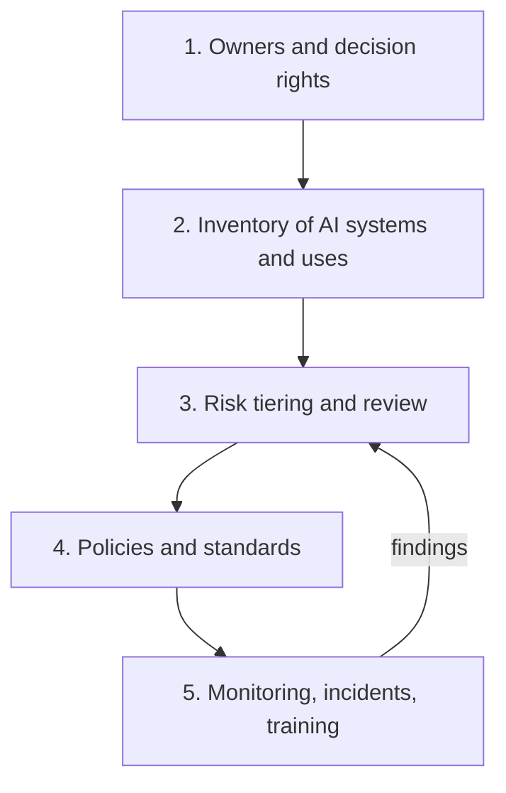

# Setting Up an AI Governance Program

**In one line:** A working AI governance program is five things (named owners, an inventory of AI use, risk-tiered review, a few clear policies, and ongoing monitoring) that you can stand up in 90 days and then map onto NIST AI RMF, ISO/IEC 42001 or the EU AI Act as needed.
**Last reviewed:** 2026-10-21

---

## The short version

- **Governance is how an organisation decides which AI uses are allowed, under what conditions, and who is accountable.** It should speed up safe adoption, not block it.
- Start with **an inventory**: you cannot govern AI you do not know about. Most organisations find far more AI use than they expected, much of it inside vendor products.
- **Tier by risk.** A meeting summariser and a model that screens job applicants should not go through the same process. Light-touch for low risk, real review for high risk.
- Write **a few short policies** people will actually read: acceptable use, a review process for new AI systems, and data rules.
- **Use a framework as a map, not a project.** NIST AI RMF (voluntary, US) and ISO/IEC 42001 (certifiable) organise the work; the EU AI Act sets legal duties if you are in scope.
- A realistic first 90 days is below, with templates.

## Why bother

- **Legal exposure.** The EU AI Act applies to many organisations that sell into or operate in the EU, and US state laws on AI in hiring, insurance and consumer decisions keep arriving. See the [EU AI Act explainer](../../explainers/policy/eu-ai-act.md) and [US AI policy](../../explainers/policy/us-ai-policy.md).
- **Real harms.** Biased decisions, leaked data, confident wrong answers given to customers, agents taking actions nobody approved.
- **Speed.** Without a clear path to "yes", teams either wait indefinitely or use AI in the shadows. A good program gives a fast lane for low-risk use.
- **Customers ask.** Enterprise buyers increasingly send AI questionnaires; a program lets you answer them.

## The five building blocks

### 1. Owners and decision rights

| Role | Who, typically | Responsibilities |
|---|---|---|
| **Executive sponsor** | A C-level or VP | Sets risk appetite, unblocks, owns the program's existence |
| **AI governance lead** | Someone in risk, legal, security, data or a CTO office | Runs the process, keeps the inventory, reports to the sponsor |
| **AI review group** | Legal, privacy, security, data/ML, a business representative, HR where relevant | Reviews medium and high-risk uses; meets on a schedule (for example every two weeks) |
| **System owner** | The business or product owner for each AI use | Accountable for that system: risk assessment, monitoring, incidents |
| **Everyone** | All staff | Follow the acceptable use policy; report concerns |

Keep the review group small. Five people who meet reliably beat fifteen who cannot find a date.

A simple RACI for a new AI system:

| Activity | System owner | Governance lead | Review group | Security / privacy | Sponsor |
|---|---|---|---|---|---|
| Register in inventory | R | A | I | I | - |
| Risk tiering | R | A | C | C | - |
| Risk assessment (medium/high) | R | C | A | C | I |
| Approve high-risk use | C | R | R | C | A |
| Ongoing monitoring | R/A | I | I | C | - |
| Incident response | R | A | C | R | I |

R = responsible, A = accountable, C = consulted, I = informed.

### 2. Inventory

A spreadsheet is fine to start. For each AI system or use, record:

| Field | Example |
|---|---|
| Name and description | "Support reply drafting" |
| Owner | Head of Support |
| Type | Bought SaaS / built on API / self-hosted model / vendor feature |
| Vendor and model | Vendor X, using a third-party LLM |
| Users | 120 support agents |
| People affected | Customers who receive replies |
| Data used | Customer emails, order history (personal data: yes) |
| Decision impact | Drafts only; human sends |
| Risk tier | Medium |
| Status | Live since 2026-03; last reviewed 2026-09 |
| Regulatory flags | GDPR; not EU AI Act high-risk |

Find entries by asking teams, checking expense and procurement records for AI tools, reviewing SSO app lists, and asking major vendors which AI features are switched on in products you already own.

### 3. Risk tiering and review

| Tier | Typical examples | Process |
|---|---|---|
| **Low** | Approved chat assistant for drafting; summarising internal docs; coding assistants with review | Self-service under the acceptable use policy; register in inventory |
| **Medium** | Customer-facing chatbot; AI on personal data; agents that take reversible actions | Short risk assessment, security and privacy check, governance lead sign-off |
| **High** | AI that affects access to jobs, credit, housing, education, health or essential services; safety-critical uses; autonomous actions with money or legal effect; anything the EU AI Act lists as high-risk | Full [risk assessment](ai-risk-assessment.md), review group approval, documented human oversight, testing for bias and robustness, monitoring plan |
| **Prohibited** | Uses banned by law (for example practices listed in Article 5 of the EU AI Act) or by your policy | Not allowed |

The [AI risk assessment](ai-risk-assessment.md) page has a template you can copy.

### 4. Policies

Keep each short. Three are enough to start:

1. **Acceptable use policy** for staff: approved tools, what data may go into them, review of outputs, disclosure. Template: [acceptable use policy](../../work/enablement/acceptable-use-policy.md).
2. **AI system review standard**: how to register, how tiering works, what each tier must produce before going live.
3. **Responsible AI principles**: what the organisation commits to (fairness, transparency, human oversight, privacy, security, accountability), stated in plain words and tied to concrete practices. See [responsible AI basics](responsible-ai-basics.md).

Supporting standards can come later: vendor AI due diligence, model and prompt change management, AI incident response, and transparency notices for users.

### 5. Monitoring, incidents and training

- **Review cadence**: high-risk systems at least every six months, or on any significant change (new model, new data, new use).
- **Incident process**: how to report an AI failure (harmful output, data leak, biased outcome, rogue agent action), who triages, and how lessons feed back. Reuse your security incident process where you can.
- **Metrics for the program**: inventory size and coverage, review turnaround time, share of systems with a current assessment, incidents and time to resolve, training completion.
- **Training**: short role-based sessions; see [training your team](../../work/enablement/training-your-team.md).
- **Technical monitoring**: quality, safety and drift for built systems; see [LLMOps and observability](../../build/patterns/llmops-observability.md).

## Mapping to frameworks

You do not need to adopt a framework wholesale on day one, but mapping your program to one helps with audits, customers and regulators.

| Your building block | NIST AI RMF function | ISO/IEC 42001 area | EU AI Act link |
|---|---|---|---|
| Owners, policies, principles | Govern | Leadership, policy, roles (clause 5) | Provider and deployer obligations need named accountability |
| Inventory and context | Map | Context of the organisation, planning (clauses 4, 6) | Classification of systems by risk |
| Risk assessment and testing | Measure | AI risk assessment and impact assessment (clauses 6, 8) | High-risk requirements: risk management, data governance, accuracy, robustness |
| Controls, oversight, incidents | Manage | Operation, monitoring, improvement (clauses 8-10) | Human oversight, logging, post-market monitoring, serious incident reporting |

- **NIST AI RMF 1.0** (January 2023) is voluntary and organised around four functions: Govern, Map, Measure, Manage. NIST's Generative AI Profile (NIST AI 600-1, July 2024) adds risks specific to generative AI. Guide: [NIST AI RMF](nist-ai-rmf.md).
- **ISO/IEC 42001:2023** specifies an AI management system that organisations can be certified against, in the same family as ISO 27001. Guide: [ISO 42001](iso-42001.md).
- **EU AI Act**: legal obligations by risk tier and role. As of 2026-10, prohibitions and general-purpose model duties already apply, and the high-risk system obligations were moved by the 2026 AI Omnibus to 2 December 2027 (stand-alone uses) and 2 August 2028 (AI in regulated products). Guide: [EU AI Act compliance](eu-ai-act-compliance.md); background: [EU AI Act explainer](../../explainers/policy/eu-ai-act.md).

## Your first 90 days

| Weeks | Do | Output |
|---|---|---|
| 1-2 | Name a sponsor and lead; agree scope and risk appetite in one page | Charter |
| 2-4 | Publish an interim acceptable use policy and an approved-tools list | Policy v1 |
| 3-6 | Build the inventory; find shadow use without punishing it | Inventory v1 |
| 5-8 | Define tiers; risk-assess the top 3-5 highest-risk uses | Tiering standard; assessments |
| 6-10 | Stand up the review group and a simple intake form | Working review process |
| 8-12 | Training for staff and builders; incident process; first report to leadership | Training, incident runbook, dashboard |
| 12 | Choose a framework to align to (NIST or ISO 42001) and plan the gap analysis | Roadmap for year one |

## Common mistakes

- **Governance as a ban.** If the only answer is "no", use goes underground. Publish approved tools and a fast lane.
- **Policy with no inventory.** Rules nobody can check.
- **Same process for everything.** Low-risk uses drown the review group; high-risk ones get a rubber stamp.
- **Owned only by legal or only by engineering.** You need both, plus the business.
- **Ignoring vendor AI.** Much of your AI exposure is features switched on in tools you already buy.
- **One-off reviews.** Models, data and uses change. Re-review on change and on a schedule.

## Next steps

- [AI risk assessment](ai-risk-assessment.md) (template) and [responsible AI basics](responsible-ai-basics.md)
- Frameworks: [NIST AI RMF](nist-ai-rmf.md), [ISO 42001](iso-42001.md), [EU AI Act compliance](eu-ai-act-compliance.md)
- Rollout: [AI adoption playbook](../../work/enablement/ai-adoption-playbook.md), [AI champions program](../../work/enablement/ai-champions-program.md)
- Security side: [OWASP LLM Top 10](../security/owasp-llm-top-10.md), [AI threat modeling](../security/ai-threat-modeling.md)
- How frontier labs govern their own models: [frontier safety frameworks](../../explainers/policy/frontier-safety-frameworks.md)

## Sources

- NIST, AI Risk Management Framework (AI RMF 1.0, January 2023): https://www.nist.gov/itl/ai-risk-management-framework
- NIST AI 600-1, Generative Artificial Intelligence Profile (July 2024): https://doi.org/10.6028/NIST.AI.600-1
- ISO/IEC 42001:2023, Artificial intelligence management system: https://www.iso.org/standard/81230.html
- European Commission, AI Act regulatory framework (risk tiers, timeline as amended by the AI Omnibus): https://digital-strategy.ec.europa.eu/en/policies/regulatory-framework-ai
- Regulation (EU) 2024/1689, Article 5 (prohibited practices): https://eur-lex.europa.eu/eli/reg/2024/1689/oj
