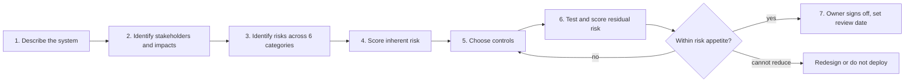

# How to Run an AI Risk Assessment

**In one line:** Describe the system and who it affects, list what could go wrong across six risk categories, score likelihood and impact, decide controls and residual risk, and get a named owner to sign it off; this page gives you a copyable template and a worked example.
**Last reviewed:** 2026-10-21

---

## The short version

- An AI risk assessment answers four questions: **What is the system? What could go wrong? How bad and how likely? What will we do about it, and who accepts what is left?**
- Do one for every medium or high-risk AI use in your [governance program](ai-governance-program.md), before launch and again on significant change.
- Use **six risk categories** so you do not miss whole areas: performance, safety and misuse, fairness, privacy and data, security, and legal and reputational.
- Score each risk **before** and **after** controls. The after score is the **residual risk**, and someone with authority must accept it.
- Keep it short. A useful assessment is 3 to 6 pages. A 60-page document nobody reads is worse than none.
- The template below maps to NIST AI RMF's Map, Measure and Manage functions and to the risk assessment clauses of ISO/IEC 42001.

## The process



Who should be in the room: the system owner, someone who built it, someone who will use it, and reviewers from privacy, security and legal. For high-risk uses, try to include the perspective of the people affected (for example, a customer advocate or an HR representative for an employee-facing system).

## The six risk categories

| Category | Example risks for an LLM-based system |
|---|---|
| **Performance** | Wrong or invented answers ([hallucinations](../../learn/concepts/hallucinations.md)); quality drops on some inputs; degradation after a model update |
| **Safety and misuse** | Harmful content; dangerous advice; users relying on it for things it was not designed for; agents taking unintended actions |
| **Fairness** | Worse quality or outcomes for some groups, languages or dialects; biased decisions about people |
| **Privacy and data** | Personal data used without lawful basis; data sent to a vendor that retains or trains on it; outputs revealing personal data |
| **Security** | [Prompt injection](../security/prompt-injection-explained.md); data exfiltration through tools; jailbreaks; poisoned models or data; see [OWASP LLM Top 10](../security/owasp-llm-top-10.md) and [AI threat modeling](../security/ai-threat-modeling.md) |
| **Legal, compliance and reputation** | Prohibited or high-risk use under the EU AI Act; sector rules; copyright; misleading customers; a public incident |

## Scoring

Use a simple 1 to 5 scale for each.

**Likelihood:** 1 rare, 2 unlikely, 3 possible, 4 likely, 5 almost certain (at your expected volume, over a year).

**Impact:** 1 negligible, 2 minor (easily corrected, internal), 3 moderate (affects customers, recoverable), 4 major (harm to individuals, regulatory attention, significant cost), 5 severe (serious harm, legal breach, lasting reputational damage).

**Risk score = likelihood x impact.** Then:

| Score | Rating | Typical response |
|---|---|---|
| 1-4 | Low | Accept; monitor |
| 5-9 | Medium | Reduce where practical; owner accepts the rest |
| 10-16 | High | Must reduce before launch; senior sign-off for residual |
| 20-25 | Critical | Do not launch until reduced; redesign if necessary |

Volume matters for likelihood. An error that happens in 1 in 1,000 conversations is "almost certain" at 100,000 conversations a month.

## Template (copy this)

```markdown
# AI Risk Assessment: <system name>

Version: <n>   Date: <YYYY-MM-DD>   Next review: <date or trigger>
System owner: <name, role>   Assessors: <names>   Risk tier: <low / medium / high>

## 1. System description
- Purpose and expected benefit:
- Users (who operates it) and volume:
- People affected (who receives outputs or decisions):
- Type: bought SaaS / built on model API / self-hosted / vendor feature
- Models and vendors (with versions):
- Data in (sources, personal data yes/no, special categories yes/no):
- Outputs and what they are used for:
- Autonomy: suggests only / acts with human review / acts alone
- Tools or actions it can take:
- Where it runs and where data is stored:

## 2. Legal and policy screen
- Prohibited practice under law or our policy? (yes/no, why)
- EU AI Act category, if in scope (prohibited / high-risk / transparency duties / minimal):
- Other regulation (data protection, sector rules, employment law):
- Data protection impact assessment needed? (yes/no; link)

## 3. Risk register
| # | Category | Risk description | Likelihood (1-5) | Impact (1-5) | Inherent score | Controls | Residual L | Residual I | Residual score | Owner |
|---|----------|------------------|------------------|--------------|----------------|----------|------------|------------|----------------|-------|
| 1 |          |                  |                  |              |                |          |            |            |                |       |

## 4. Testing evidence
- Quality evaluation (test set, metric, result):
- Results across relevant groups:
- Red team / misuse testing (scope, findings, fixes):
- Security review (threat model, findings):

## 5. Human oversight and transparency
- How humans review or can override:
- What users and affected people are told:
- How affected people can challenge an outcome:

## 6. Monitoring and incident response
- Production metrics and thresholds:
- How incidents are reported and who responds:
- Kill switch or fallback:

## 7. Residual risk and sign-off
- Summary of residual risks above "low":
- Conditions of approval (for example limits on scope, required monitoring):
- Decision: approve / approve with conditions / reject
- Accepted by: <name, role, date>
```

## Worked example: AI reply drafting for customer support

**System:** an LLM drafts replies to customer emails using the help centre and the customer's order history. Agents edit and send. 30,000 emails a month. Medium tier.

| # | Category | Risk | L | I | Inherent | Controls | Residual |
|---|---|---|---|---|---|---|---|
| 1 | Performance | Draft states a wrong refund policy and the agent sends it unchanged | 4 | 3 | 12 High | Retrieval from current policy pages only; citations shown to the agent; refund amounts pulled from the orders system, not generated; weekly sample review | L2 x I3 = 6 Medium |
| 2 | Privacy | Order history of the wrong customer appears in a draft | 2 | 4 | 8 Medium | Order lookup keyed to the authenticated ticket's customer ID in code; test cases for mismatched IDs | L1 x I4 = 4 Low |
| 3 | Privacy | Vendor retains customer emails | 3 | 3 | 9 Medium | Business contract with no training on data and a short retention period; regional processing | L1 x I3 = 3 Low |
| 4 | Security | A customer email contains a prompt injection that makes the draft leak another customer's data or promise a refund | 3 | 4 | 12 High | Model has read-only access to this ticket's data only; no refund tool; injection screening; agents trained to spot odd drafts | L2 x I2 = 4 Low |
| 5 | Fairness | Lower quality drafts for non-English emails | 4 | 2 | 8 Medium | Eval set includes the five most common languages; quality per language tracked monthly | L2 x I2 = 4 Low |
| 6 | Reliance | Agents stop reading drafts carefully (automation bias) | 4 | 3 | 12 High | Drafts with low retrieval confidence flagged; random audits; edit-rate monitoring (near-zero edits triggers review) | L3 x I3 = 9 Medium |
| 7 | Legal / reputation | Customers not told AI is involved | 2 | 2 | 4 Low | Help centre notice; agent remains the sender | L1 x I2 = 2 Low |

**Decision:** approve with conditions: monthly review of risks 1 and 6 for the first quarter; re-assess on any model change. Accepted by the Head of Customer Support.

Notice the pattern: the strongest controls (risks 2 and 4) are **in code** and do not depend on the model behaving. The weakest (risk 6) depends on human behaviour, so it keeps a higher residual and gets monitoring.

## Linking to frameworks

- **NIST AI RMF:** sections 1-2 are *Map*, sections 3-4 are *Measure*, sections 5-7 are *Manage*, and sign-off and ownership are *Govern*. NIST's Generative AI Profile (AI 600-1) lists GenAI-specific risks worth checking your register against, such as confabulation, information security, and harmful content. See [NIST AI RMF](nist-ai-rmf.md).
- **ISO/IEC 42001** requires an AI risk assessment, risk treatment, and an AI system impact assessment; this template covers the core of all three. See [ISO 42001](iso-42001.md).
- **EU AI Act:** for high-risk systems, providers need a documented risk management system across the lifecycle, and certain deployers need a fundamental rights impact assessment. As of 2026-10 those high-risk duties apply from 2 December 2027 for stand-alone systems after the AI Omnibus delay. See [EU AI Act compliance](eu-ai-act-compliance.md) and the [EU AI Act explainer](../../explainers/policy/eu-ai-act.md).

## Common mistakes

- **Listing risks with no controls or owners.** A register is a to-do list, not a worry list.
- **Scoring only inherent risk.** The decision is about residual risk.
- **Controls that are all "train the users".** Prefer technical controls for anything serious.
- **Ignoring volume.** Rare per conversation can mean daily in production.
- **Writing it after launch.** The point is to change the design.
- **Never revisiting.** Set a review date and triggers (new model, new data, new use, incident).

## Next steps

- [AI governance program](ai-governance-program.md) and [responsible AI basics](responsible-ai-basics.md)
- Practise on a real system: [prompt injection red team](../../build/projects/prompt-injection-red-team.md)
- Security depth: [AI threat modeling](../security/ai-threat-modeling.md), [agent security](../security/agent-security.md)

## Sources

- NIST, AI Risk Management Framework 1.0 (Govern, Map, Measure, Manage): https://www.nist.gov/itl/ai-risk-management-framework
- NIST AI 600-1, Generative AI Profile (July 2024): https://doi.org/10.6028/NIST.AI.600-1
- ISO/IEC 42001:2023: https://www.iso.org/standard/81230.html
- Regulation (EU) 2024/1689, Article 9 (risk management system) and Article 27 (fundamental rights impact assessment): https://eur-lex.europa.eu/eli/reg/2024/1689/oj
- European Commission, AI Act regulatory framework (timeline as amended): https://digital-strategy.ec.europa.eu/en/policies/regulatory-framework-ai
