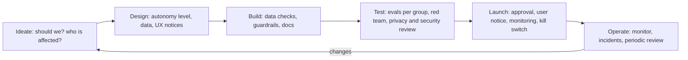

# Responsible AI Basics

**In one line:** Responsible AI means turning six principles (fairness, reliability and safety, privacy and security, transparency, human oversight, and accountability) into concrete practices you can check, at every stage from deciding whether to use AI at all to monitoring it in production.
**Last reviewed:** 2026-10-21

---

## The short version

- Most organisations publish similar responsible AI principles. The hard part is **practice**: what you actually test, document, and refuse to ship.
- The six principles here are a common core shared by the OECD AI Principles, NIST's characteristics of trustworthy AI, and most large companies' published frameworks.
- For each principle there is a short list of **practices** and **evidence** (what you could show an auditor or a customer).
- The most important question comes first: **should this be done with AI at all?** Some uses are not worth the risk, and some are illegal.
- Responsible AI is not only about the model. It covers the data, the user interface, the people affected, and what happens when it goes wrong.

## The six principles, made practical

### 1. Fairness

**What it means:** the system does not produce unjustified differences in outcomes or quality between groups of people, especially groups protected by law.

**Practices**
- Identify who is affected and which groups could be treated differently (by gender, ethnicity, age, disability, language, region).
- Test performance and outcomes per group, not only on average. For a language model feature, test with names, dialects and languages your users actually use.
- For decisions about people (hiring, lending, access to services), measure outcome rates per group and investigate gaps.
- Check training or retrieval data for gaps and historical bias.

**Evidence:** per-group evaluation results; a written rationale for any remaining gaps; mitigation decisions.

Language models absorb patterns from internet-scale data; [On the Dangers of Stochastic Parrots](../../papers/essays/150-stochastic-parrots/summary.md) is the widely cited argument about the risks of that.

### 2. Reliability and safety

**What it means:** the system works as intended, fails safely, and does not cause harm in foreseeable misuse.

**Practices**
- Define what "good enough" means before building, and measure it on a test set. See [evals for LLMs](../../learn/concepts/evals-for-llms.md).
- Test edge cases, adversarial inputs and misuse, not only the happy path. See [LLM red teaming](../security/llm-red-teaming.md).
- Design for [hallucinations](../../learn/concepts/hallucinations.md): citations, abstention ("I don't know"), and checks on consequential outputs. [Why language models hallucinate](../../papers/techniques/149-why-language-models-hallucinate/summary.md) explains why this will not simply go away.
- Add guardrails for harmful content and limits on what agents can do. See [guardrails and safety](../../learn/concepts/guardrails-and-safety.md).
- Monitor in production; have a kill switch.

**Evidence:** eval results; red-team findings and fixes; monitoring dashboards; incident log.

### 3. Privacy and security

**What it means:** personal and confidential data is used lawfully and minimally, and the system resists attack.

**Practices**
- Use only the data you need; check you have a lawful basis and that contracts allow it.
- Know where data goes: which vendor, which region, retention period, whether it is used for training.
- Protect against [prompt injection](../security/prompt-injection-explained.md), data leakage and the rest of the [OWASP LLM Top 10](../security/owasp-llm-top-10.md).
- Apply least privilege to AI agents and tools. See [agent security](../security/agent-security.md).
- Check your model and dependency supply chain. See [model supply chain](../security/model-supply-chain.md).

**Evidence:** data protection impact assessment where required; vendor due diligence; threat model; security test results.

### 4. Transparency and explainability

**What it means:** people know when they are dealing with AI, understand roughly what it does and its limits, and can get an explanation of decisions that affect them.

**Practices**
- Tell users when they are interacting with an AI system or seeing AI-generated content. The EU AI Act includes transparency duties of this kind.
- Label AI-generated images, audio and video where appropriate; consider provenance standards.
- Publish a short, plain-language notice: what the system does, what data it uses, known limits, how to reach a human.
- For decisions about people, be able to explain the main factors and offer a route to challenge them.
- Internally, keep documentation: purpose, data, model, evaluations, limits. Model cards and system cards are the common formats.

**Evidence:** user notices; system documentation; explanation and appeal process.

Research on understanding what happens inside models, such as [sparse autoencoders](../../papers/techniques/82-sparse-autoencoders/summary.md) and [circuit tracing](../../papers/techniques/151-circuit-tracing/summary.md), is promising but does not yet give you explanations of individual business decisions. Do not over-claim.

### 5. Human oversight

**What it means:** people stay meaningfully in control, especially for consequential decisions.

**Practices**
- Decide the level of autonomy deliberately: AI suggests and a human decides; AI acts and a human can review and reverse; or AI acts alone (only for low-impact, reversible tasks).
- Make oversight real: reviewers need time, training, the right information, and authority to override. A human clicking "approve" on 500 items an hour is not oversight.
- Watch for automation bias: people tend to over-trust confident machine output.
- Require approval for irreversible or external actions by agents. See [agent architectures](../../build/patterns/agent-architectures.md).

**Evidence:** documented autonomy level per system; reviewer training; override rates (an override rate near zero can mean rubber-stamping).

### 6. Accountability

**What it means:** a named person or team is answerable for each AI system and its outcomes.

**Practices**
- Every system has an owner in the [inventory](ai-governance-program.md).
- Risk assessments are signed off at the right level. See [AI risk assessment](ai-risk-assessment.md).
- Incidents are reported, investigated and learned from.
- Responsibilities are clear when vendors are involved: who fixes what, who notifies whom.

**Evidence:** owner list; approvals; incident records; contracts with clear AI terms.

## The question before all of them: should we?

Before designing controls, ask:

- **Is AI the right tool?** A rule, a form or a search box may be simpler and more reliable.
- **Who could be harmed, and how badly?** Weigh benefits and harms for the people affected, not only for the organisation.
- **Is it legal?** Some practices are prohibited outright (for example, those in Article 5 of the EU AI Act, such as social scoring). Some sectors have specific rules.
- **Would we be comfortable if this were on the front page?** A crude test that catches a lot.

## Responsible AI across the lifecycle

## A one-page checklist for a new AI feature

- [ ] Purpose and expected benefit written down
- [ ] Affected people and possible harms listed
- [ ] Legal check done (prohibited use? sector rules? data protection?)
- [ ] Risk tier assigned and assessment done if medium or high
- [ ] Data sources documented, lawful, minimised
- [ ] Quality bar defined and met on a test set
- [ ] Results checked across relevant groups
- [ ] Red-team or misuse testing done; findings fixed or accepted by the owner
- [ ] Users told they are using AI; limits stated
- [ ] Human oversight level decided and workable
- [ ] Monitoring, incident route and kill switch in place
- [ ] Owner named; review date set

## Common mistakes

- **Principles without practices.** A values page with no tests behind it.
- **Testing only averages.** Average accuracy hides who the system fails.
- **Oversight in name only.** Reviewers without time or authority.
- **"The vendor handles it."** You are still accountable for how you use a bought system.
- **One-time review.** Behaviour changes when models, data or users change.

## Next steps

- [AI governance program](ai-governance-program.md) to make this organisational
- [AI risk assessment](ai-risk-assessment.md) template
- Frameworks: [NIST AI RMF](nist-ai-rmf.md), [ISO 42001](iso-42001.md), [EU AI Act compliance](eu-ai-act-compliance.md)
- Research background: [Constitutional AI](../../papers/language-models/14-constitutional-ai/summary.md), [InstructGPT / RLHF](../../papers/language-models/05-instructgpt-rlhf/summary.md), [emergent misalignment](../../papers/techniques/153-emergent-misalignment/summary.md), [frontier safety frameworks](../../explainers/policy/frontier-safety-frameworks.md)

## Sources

- OECD, AI Principles (adopted 2019, updated 2024): https://oecd.ai/en/ai-principles
- NIST, AI Risk Management Framework 1.0 (characteristics of trustworthy AI): https://www.nist.gov/itl/ai-risk-management-framework
- Regulation (EU) 2024/1689 (AI Act), Articles 5 and 50: https://eur-lex.europa.eu/eli/reg/2024/1689/oj
- Mitchell et al., "Model Cards for Model Reporting" (2019): https://arxiv.org/abs/1810.03993
- C2PA, content provenance specification: https://c2pa.org/
