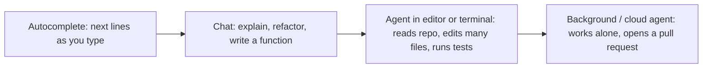

# AI Coding Assistants Compared

**In one line:** Pick a coding assistant by where you work (terminal, IDE, or delegated cloud tasks), which models you want, and how billing works, then judge it on a real week of your own tasks rather than on benchmarks.
**Last reviewed:** 2026-10-21

---

## The short version

- Coding assistants now come in three modes: **autocomplete** (suggests the next lines), **chat and agent in your editor or terminal** (reads your repo, edits files, runs commands), and **cloud or background agents** (you hand off a task and get back a pull request).
- As of 2026-10 the main options are **Claude Code**, **GitHub Copilot**, **Cursor**, **OpenAI Codex**, **Google's Gemini CLI and related tools**, and open-source agents such as **OpenCode** and **Aider** that work with any model.
- Prices are mostly a flat monthly plan with **usage limits or credits** on top. Heavy agent use can hit limits fast. Read the usage rules, not just the headline price.
- **Pick Claude Code** if you live in the terminal and want a strong autonomous agent; **Copilot** if your team is on GitHub and wants the cheapest broad option with admin controls; **Cursor** if you want an AI-first editor (note its 2026 ownership change and Grok-first plans); **Codex** if you already pay for ChatGPT; **Gemini CLI** for a free, open-source starting point; **OpenCode or Aider** if you want to bring your own model or run locally.
- Whatever you choose: review every diff, keep secrets out of prompts, and run the tests. The assistant writes code; you own it.

## What these tools actually do

Moving right, the tool does more on its own, saves more time on well-specified tasks, and needs more careful review. The research behind this progress: [Codex (2021)](../../papers/language-models/56-codex/summary.md) for code models, [SWE-bench](../../papers/techniques/84-swe-bench/summary.md) for measuring agents on real GitHub issues, and [METR time horizons](../../papers/techniques/145-metr-time-horizons/summary.md) for how long a task agents can finish. Benchmarks and their limits: [maths and code benchmarks](../../explainers/benchmarks/math-and-code.md).

## Comparison table (as of 2026-10)

| Tool | Where it runs | Models | Individual pricing (USD/month) | Team / admin | Best at |
|---|---|---|---|---|---|
| **Claude Code** (Anthropic) | Terminal, IDE extensions, desktop and web | Claude models | Included in Claude Pro ($20, $17 annual) and Max (from $100); shares the plan's usage limits | Team ($25 standard seat, $125 premium seat; lower annual) and Enterprise | Autonomous multi-file work from the terminal; MCP tools; scripting via the Agent SDK |
| **GitHub Copilot** | VS Code, JetBrains, Visual Studio, other IDEs, CLI, github.com | Several providers' models | Free (2,000 completions + 50 chat requests a month), Pro $10, Pro+ $39, Max $100; paid plans include monthly AI Credits for chat, agents and review | Business and Enterprise (contact sales); Enterprise adds codebase indexing and customisation | Broad IDE coverage, code review and cloud agent inside GitHub, org policy controls |
| **Cursor** | Its own editor (a VS Code fork), cloud agents | Grok models first; third-party models at API rates on higher plans | Free; Plus $8 (Grok only); Premium $30; Super $100; Ultra $200 | Teams from $30 per user | AI-first editing experience, fast multi-file edits |
| **OpenAI Codex** | CLI (open source), IDE extension, cloud tasks from ChatGPT | OpenAI models | Included with ChatGPT plans; check OpenAI's pricing page for current tiers | ChatGPT Business and Enterprise | Users already on ChatGPT; delegated cloud tasks |
| **Gemini CLI** (Google) | Terminal | Gemini models | Free tier with a personal Google account; higher limits with paid Google AI plans or an API key | Via Google Cloud | Free, open-source (Apache 2.0) terminal agent |
| **OpenCode, Aider** (open source) | Terminal | Any provider, or local models | Free software; you pay the model provider (or nothing, with a local model) | Self-managed | Model choice, local or private setups, no vendor lock-in |

Notes on the table:

- **Cursor ownership changed in 2026.** Press reports say SpaceX's AI unit (which absorbed xAI) completed an acquisition of Cursor's parent Anysphere in August 2026, and Cursor's current plans centre on Grok models with other models billed at API rates. If you chose Cursor for access to a particular non-Grok model, re-check what your plan includes.
- **Google** notes on the Gemini CLI repository that the CLI is not optimised for its newest Gemini 4 model and points users to a newer "Antigravity" CLI. Expect Google's lineup here to keep shifting.
- Copilot's free and paid quotas, and every plan above, change often. Check the source links before buying for a team.

## How to choose

**Pick Claude Code if** you are comfortable in a terminal, want an agent that can plan and carry out large changes across a repo, and want to extend it with MCP servers and custom commands. It is also the most scriptable: the same harness is available as the Claude Agent SDK. See [build a Claude agent with MCP](../../build/projects/build-claude-agent-with-mcp.md).

**Pick GitHub Copilot if** your organisation already uses GitHub and wants one approved tool for everyone, across many IDEs, with central policy and the lowest entry price. Copilot code review and its cloud agent work directly on pull requests.

**Pick Cursor if** you want the editor itself to be built around AI (inline edits, multi-file changes, cloud agents) and you are happy with Grok models or paying API rates for others.

**Pick OpenAI Codex if** you or your company already pay for ChatGPT and want to try an agent without another subscription.

**Pick Gemini CLI if** you want a free, open-source terminal agent to learn on, or you are on Google Cloud.

**Pick OpenCode or Aider if** you need to choose your own model, run against a [local model](local-llm-runners.md) for privacy, or avoid lock-in. Expect more setup and weaker results with small local models.

Many developers use two: an IDE assistant for everyday edits and a terminal or cloud agent for larger tasks.

## How to evaluate one in a week

Benchmarks tell you little about your codebase. Run your own trial:

1. **Pick 10 real tasks** from your backlog: two bug fixes, two small features, a refactor, tests for untested code, a dependency upgrade, a documentation task, an unfamiliar-codebase question, and one hard task.
2. **Run each tool on the same tasks.** Give the same instructions.
3. **Score**: did it finish? How many corrections did you make? Did the tests pass? Any security or quality issues in review? Time spent, including review.
4. **Check cost**: how far into the plan's limits did the week take you?
5. **Decide** on finished-and-correct tasks per hour of your time, not on how impressive the demo felt.

## Safe use

- **Review every diff.** Treat agent output like a pull request from a fast, confident junior colleague.
- **Keep secrets out.** Do not paste credentials into chats; check what files the agent can read; use `.gitignore`-style ignore files the tool supports.
- **Limit permissions.** Agents that run shell commands should ask before destructive commands. Run them in containers or dev environments, not on production machines.
- **Watch for prompt injection.** A README, issue or web page the agent reads can contain instructions. See [agent security](../../safety/security/agent-security.md).
- **Check licences and policy.** Your employer may have rules on which tools and models are allowed. See [acceptable use policy](../../work/enablement/acceptable-use-policy.md) and [coding assistants in practice](../../work/use-cases/coding-assistants-in-practice.md).
- **Keep learning the fundamentals.** If you are early in your career, make sure you can explain every line you ship. See [AI engineer roadmap](../../careers/roles/ai-engineer-roadmap.md).

## Common mistakes

- **Judging by the demo.** Run your own tasks.
- **Accepting large diffs unread.** Bugs and security issues hide in volume.
- **Ignoring usage limits.** Agent-heavy weeks can exhaust a plan. Know what happens at the limit (throttling, pay-as-you-go, or a stop).
- **One giant prompt.** Agents do better with a clear goal, constraints, and how to verify (for example, "make the tests in `tests/api` pass").
- **No project instructions file.** Most tools read a repository instructions file (for example `CLAUDE.md` or `AGENTS.md`). A short one with build commands and conventions improves results a lot.

## Next steps

- [Coding assistants in practice](../../work/use-cases/coding-assistants-in-practice.md) and [the engineers' playbook](../../work/playbooks/for-engineers.md)
- [Agent architectures](../../build/patterns/agent-architectures.md) to understand what these tools do inside
- [Chat assistants](chat-assistants.md) and [local LLM runners](local-llm-runners.md)
- [Which model for which job](../decisions/which-model-for-which-job.md)

## Sources

- Anthropic, Claude plans and pricing (Pro, Max, Team, Enterprise; Claude Code included; as of 2026-10): https://claude.com/pricing
- GitHub, Copilot plans (Free limits, Pro, Pro+, Max, AI Credits, Business/Enterprise; as of 2026-10): https://github.com/features/copilot/plans
- Cursor, Pricing (Free, Plus, Premium, Super, Ultra, Teams; as of 2026-10): https://cursor.com/pricing
- tbreak, report on Grok 4.6 in Cursor and the SpaceXAI acquisition of Anysphere (closed 14 August 2026): https://tbreak.com/grok-4-6-cursor-spacexai-acquisition/
- Google, Gemini CLI repository (Apache 2.0, install, Antigravity CLI note; as of 2026-10): https://github.com/google-gemini/gemini-cli
- OpenAI, Codex CLI repository: https://github.com/openai/codex
- OpenCode: https://github.com/sst/opencode ; Aider: https://github.com/Aider-AI/aider
