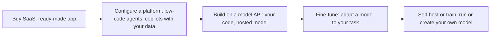

# Build vs Buy for AI

**In one line:** Buy an off-the-shelf AI product when the job is common and not your differentiator, build on a model API when the workflow is yours, and only train or self-host models when data, scale or control force you to; decide with total cost of ownership and a 90-day pilot, not a demo.
**Last reviewed:** 2026-10-21

---

## The short version

- "Build vs buy" for AI is really a **spectrum of five options**: buy a SaaS product, configure a platform, build on a model API, fine-tune a model, or train or self-host your own.
- **Buy** when the use case is generic (meeting notes, coding assistance, general chat, support ticket deflection) and vendors have years of polish you cannot match.
- **Build on an API** when the AI touches your own data, workflows or product in a way no vendor understands. This is where most companies get differentiated value.
- **Fine-tune or self-host** only when you have a clear reason: strict data control, very high steady volume, a narrow task where a small tuned model beats a large general one, or offline needs.
- Compare on **total cost of ownership** (licences or tokens plus engineering, evaluation, operations and change management), and on **exit cost** if the vendor or model disappoints.

## The spectrum

| Option | Example | Time to value | Control | Ongoing effort | Typical risk |
|---|---|---|---|---|---|
| **Buy SaaS** | Enterprise chat assistant, AI meeting notes, coding assistant, support bot vendor | Days to weeks | Low | Low: vendor management, admin | Lock-in, data terms, generic fit |
| **Configure a platform** | Low-code agent builders, assistants grounded in your SharePoint or Drive | Weeks | Medium | Medium: content, permissions | Platform limits; quality on edge cases |
| **Build on an API** | Your own RAG assistant, extraction pipeline, product feature | Weeks to months | High | Medium to high: engineering, evals, ops | Engineering cost; you own quality |
| **Fine-tune** | Small model tuned on 10,000 labelled examples | Months | High | High: data pipeline, retraining | Data quality; model drift |
| **Self-host or train** | Open-weight model on your GPUs; pre-training from scratch | Months to years | Total | Very high: infra, ML team | Cost, talent, obsolescence |

Pre-training a general model from scratch is out of reach for almost every organisation: see [cost of training](../../explainers/compute/cost-of-training.md). Fine-tuning is cheaper than it was thanks to [LoRA](../../papers/techniques/10-lora/summary.md) and [QLoRA](../../papers/techniques/22-qlora/summary.md), but it is rarely the first thing to try. See [fine-tuning vs RAG](../../learn/concepts/fine-tuning-vs-rag.md).

## Decision questions

Answer these honestly before choosing.

1. **Is this a differentiator?** If customers choose you because of it, lean towards building. If it is internal productivity that every company needs, lean towards buying.
2. **How unique is the data or workflow?** Generic documents and processes favour buying. Proprietary data joined across your own systems favours building.
3. **What data can leave your boundary?** Check classification and contracts. Many vendors offer no-training, retention and regional controls; some workloads still need self-hosting.
4. **Do you have the skills?** Building needs engineers who can do prompts, retrieval, evals and operations. Fine-tuning and self-hosting need ML and infrastructure skills too. See [AI careers map](../../careers/roles/ai-careers-map.md).
5. **What volume and growth?** Low or bursty volume favours paying per use. High, steady volume can favour self-hosting, if utilisation stays high.
6. **How fast does it need to change?** Vendor roadmaps move on their schedule. Your own build moves on yours.
7. **What is the exit plan?** Can you export data, prompts and configurations? Can you switch models?

## Total cost of ownership

Headline prices mislead in both directions. Count everything for a realistic year.

| Cost line | Buy | Build on API | Self-host |
|---|---|---|---|
| Licences / seats | Main cost | Low (tooling) | Low |
| Model usage | Included or metered | Tokens | GPUs: owned or rented, idle time included |
| Engineering to build | Integration only | Significant | Significant plus infra |
| Evaluation and quality | Vendor's, plus your acceptance tests | Yours, ongoing | Yours, ongoing |
| Operations and on-call | Vendor | You | You, including hardware and scaling |
| Security and compliance review | Vendor assessment | Your architecture review | Your full stack |
| Change management and training | Needed in every option | Needed | Needed |
| Switching cost later | Can be high | Moderate if you used a gateway | Moderate |

A worked comparison for an internal policy assistant used by 2,000 staff:

- **Buy:** an enterprise assistant with document grounding. Cost is mostly seats (vendors price enterprise seats in the tens of dollars per user per month as of 2026-10; for example, Anthropic lists Claude Enterprise from $20 per seat per month with a 20-seat minimum, plus usage at API rates). Live in weeks. Limited control over retrieval quality.
- **Build:** a RAG app on an API. Token costs might be a few hundred to a few thousand dollars a month at this scale, but one or two engineers for three months to build, then part of an engineer to run and improve it. Full control and fits your permissions model.
- The right answer depends on whether policy Q&A is a differentiator (rarely) and whether the bought product handles your document permissions correctly (test it).

For token arithmetic, see [cost and latency control](../../build/patterns/cost-and-latency-control.md). For vendor comparisons, see [choosing enterprise AI tools](../../work/enablement/choosing-enterprise-ai-tools.md), [GenAI platforms](../comparisons/genai-platforms.md) and [cloud AI/ML services](../comparisons/cloud-ai-ml-services.md).

## The hybrid that usually wins

Most organisations end up with:

- **Bought** general productivity tools for everyone (a chat assistant, a coding assistant, meeting notes).
- **Built** AI features in their own products and core workflows, on model APIs through a gateway so they can switch models.
- **A small number of tuned or self-hosted models** for specific high-volume or sensitive tasks, only after the API version proved the value.

This mirrors the advice in [LLM app architecture](../../build/patterns/llm-app-architecture.md): start with the simplest thing that works, and add control where measurement shows you need it.

## Running a fair evaluation

1. **Write the success criteria first**: tasks, quality bar, latency, cost per task, security requirements.
2. **Build a test set** from real work (50 to 200 cases).
3. **Shortlist** two vendors and one build prototype.
4. **Run a time-boxed pilot** (about 90 days) with real users and the same test set for every option.
5. **Score** quality on the test set, adoption and satisfaction in the pilot, total cost of ownership, security review findings, and exit cost.
6. **Decide and write down why**, with a date to revisit. AI products and models change fast; a decision that was right this year may not be next year.

## Vendor due diligence checklist

- [ ] Does the vendor train on your data? Can you opt out contractually?
- [ ] Data retention period, deletion process, and data residency options
- [ ] Which underlying models, and will they notify you of model changes?
- [ ] Security certifications (for example SOC 2, ISO 27001, and [ISO 42001](../../safety/governance/iso-42001.md) for AI management)
- [ ] Single sign-on, role-based access, audit logs
- [ ] Respects your existing document permissions when grounding answers
- [ ] Admin controls for features (web access, connectors, agents)
- [ ] Export of data, prompts and configurations
- [ ] Pricing model and what happens when usage limits are hit
- [ ] Incident response and uptime commitments
- [ ] Alignment with your [AI risk assessment](../../safety/governance/ai-risk-assessment.md) and regulatory needs ([EU AI Act compliance](../../safety/governance/eu-ai-act-compliance.md))

## Common mistakes

- **Building a generic tool you could have bought.** Six months of engineering to make an inferior chat assistant.
- **Buying for a differentiating use case.** Your competitors can buy the same thing.
- **Comparing seat price to token price.** Include engineering, evaluation and operations.
- **Self-hosting for cost at low volume.** Idle GPUs are expensive.
- **Fine-tuning to add knowledge.** Retrieval is usually cheaper and easier to update.
- **No exit plan.** Use a gateway and keep prompts and data portable.

## Next steps

- [Which model for which job](which-model-for-which-job.md)
- [LLM serving](llm-serving.md) and [vector database](vector-database.md) decisions if you build
- [AI adoption playbook](../../work/enablement/ai-adoption-playbook.md) and [measuring AI ROI](../../work/enablement/measuring-ai-roi.md)
- [AI for leaders](../../learn/start-here/ai-for-leaders.md)

## Sources

- Anthropic, Claude plans and pricing (Enterprise seat price and minimum; as of 2026-10): https://claude.com/pricing
- Hu et al., "LoRA: Low-Rank Adaptation of Large Language Models" (2021): https://arxiv.org/abs/2106.09685
- Anthropic, "Building effective agents" (start simple): https://www.anthropic.com/engineering/building-effective-agents
- ISO/IEC 42001:2023, AI management system: https://www.iso.org/standard/81230.html
