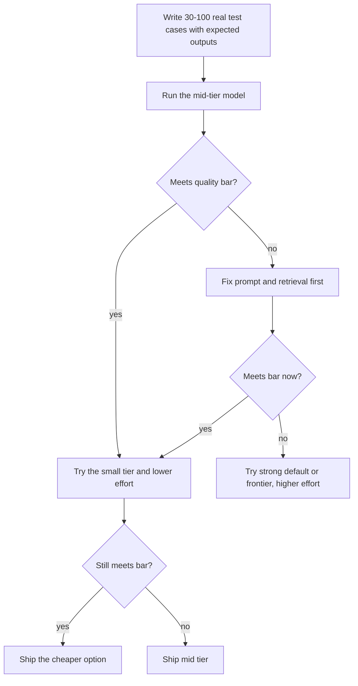

# Which Model for Which Job

**In one line:** Match the model tier to the task (small and fast for high-volume simple work, mid-tier for most products, the frontier tier for hard reasoning and long agent runs, open weights when data or cost demand it) and confirm the choice on your own eval set, not on leaderboards.
**Last reviewed:** 2026-10-21

---

## The short version

- Every major provider sells a **ladder**: a small fast model, a mid-tier workhorse, and a frontier model. Prices across one ladder differ by 20x to 100x as of 2026-10.
- **Default to the mid tier** for a new product, then move individual routes down (to save money) or up (to fix quality) based on evals.
- **Small models** handle classification, extraction, routing and short replies very well. **Frontier models** earn their price on hard reasoning, complex code and long autonomous agent runs.
- **Reasoning effort is a second dial.** The same model at lower effort can be much cheaper and faster; test that before switching models.
- **Open-weight models** make sense for privacy, offline use, fine-tuning or very high steady volume. They trail the best closed models but the gap is small for many tasks.
- Model names below were current on 2026-10-21. They change every few months. The method on this page does not.

## The current ladders (as of 2026-10)

Prices are list prices per million tokens, input / output, standard tier, from each provider's own pages. Batch and cached input are cheaper.

| Tier | Anthropic (Claude) | OpenAI | Google (Gemini) |
|---|---|---|---|
| **Frontier** | Claude Fable 5.1 (`claude-fable-5-1`), $10 / $50: "for demanding reasoning and long-horizon agentic work" | GPT-6 Astra (`gpt-6-astra`), $10 / $50: "most capable model for the most demanding work" | Gemini 4 Argon (`gemini-4-argon`), $2 / $10 promotional through 30 Nov 2026, then $4 / $20 |
| **Strong default** | Claude Opus 5.5 (`claude-opus-5-5`), $4 / $20: Anthropic's suggested starting point "for most workloads" | GPT-6.1 Sol (`gpt-6.1-sol`), $2 / $10: "near-Astra performance... at a lower cost" | Gemini 3.1 Pro Preview, $2 / $12 (up to 200k-token prompts) |
| **Fast mid tier** | Claude Sonnet 5.5 (`claude-sonnet-5-5`), $2 / $10: "the best combination of speed and intelligence" | (Sol covers this tier) | Gemini 3.8 Flash (`gemini-3.8-flash`), $0.75 / $3.75 promotional through 31 Dec 2026, then $1.50 / $7.50 |
| **Small / high volume** | Claude Haiku 5.5 (`claude-haiku-5-5`), from $0.10 / $0.50: "classification, extraction, and routing" | GPT-6 Luna (`gpt-6-luna`), $0.10 / $0.50: "focused, high-volume tasks" | Gemini 3.5 Flash-Lite, $0.30 / $2.50 |

Notes: Claude Haiku 5.5's price rises to $0.50 / $2.50 for prompts over 100,000 tokens. Gemini Pro-tier prices rise for prompts over 200,000 tokens. Google offers a free API tier on its Flash and Flash-Lite models. All of these accept text and images; check each provider's docs for audio, video and tool support. For the lab histories behind these names, see [Claude](../../explainers/model-families/claude.md), [GPT](../../explainers/model-families/gpt.md) and [Gemini](../../explainers/model-families/gemini.md).

**Open-weight families** you can run yourself or rent from many hosts include Qwen, Llama, DeepSeek, Mistral, Gemma and OpenAI's gpt-oss. See [open vs closed weights](../../explainers/concepts/open-vs-closed-weights.md), [Qwen](../../explainers/model-families/qwen.md), [Llama](../../explainers/model-families/llama.md), [DeepSeek](../../explainers/model-families/deepseek.md), [Mistral](../../explainers/model-families/mistral.md) and [local LLM runners](../comparisons/local-llm-runners.md).

## Job-by-job guidance

| Job | Start with | Why | Move up if | Move down if |
|---|---|---|---|---|
| Classification, tagging, routing | Small tier | Short outputs, easy decisions, huge volume | Accuracy on your labelled set is too low | - |
| Extraction to JSON | Small tier with structured outputs | Schema-constrained, checkable | Field accuracy below target on gold set | - |
| Customer-facing chat | Fast mid tier | Latency matters; quality must be good | Complaints about wrong or shallow answers | Simple FAQ traffic |
| RAG question answering | Fast mid tier | Retrieval quality usually matters more than model size | Multi-document synthesis fails | Short factual lookups |
| Summarisation | Small or fast mid tier | Mostly a reading task | Long, technical or legal documents | - |
| Writing and editing | Strong default | Tone and nuance benefit from capability | - | Templates and short copy |
| Coding assistance | Strong default or frontier | Code quality and multi-file reasoning scale with capability | Large refactors, unfamiliar codebases | Autocomplete, boilerplate |
| Long autonomous agents | Strong default or frontier, high effort | Errors compound over many steps | Agent stalls or loops on hard tasks | Short tool loops |
| Hard maths, science, analysis | Frontier, high effort | Benefits from long reasoning | - | Routine calculations (use code instead) |
| Sub-agents and workers in a multi-agent system | Small or fast mid tier | Read a lot, return short summaries | Workers miss key details | - |
| Voice | Small or fast mid tier, or a realtime voice model | Latency dominates | Answers too shallow | - |
| Sensitive data that cannot leave your network | Open-weight model, self-hosted | Data control | Quality not good enough: consider a private cloud deployment of a closed model | - |

For why reasoning effort matters so much, see [reasoning models](../../explainers/concepts/reasoning-models.md). For the cost arithmetic, see [cost and latency control](../../build/patterns/cost-and-latency-control.md).

## How to choose, properly

1. **Build the test set first.** Real inputs, expected outputs, and a scoring method. See [set up an eval harness](../../build/projects/set-up-eval-harness.md).
2. **Fix the prompt and context before buying a bigger model.** Many "the model is not smart enough" problems are missing context.
3. **Measure cost per completed task and latency**, not just accuracy.
4. **Re-run when models change.** New releases arrive every few months; your test set makes switching a one-day job.

## Why leaderboards are not enough

Public benchmarks are useful for a shortlist and misleading for a final decision. Scores saturate, test data leaks into training data, and benchmark tasks rarely look like yours. Read [contamination and saturation](../../explainers/benchmarks/contamination-and-saturation.md), [human preference arenas](../../explainers/benchmarks/human-preference-arenas.md), [knowledge and reasoning benchmarks](../../explainers/benchmarks/knowledge-and-reasoning.md) and [agent benchmarks](../../explainers/benchmarks/agents-and-computer-use.md).

## Other factors that can decide it

- **Where you can buy it.** Claude is available through Anthropic and the major clouds (Amazon Bedrock, Google Cloud, Microsoft Foundry). OpenAI models are available through OpenAI and Microsoft Azure. Gemini through Google. Your cloud contract or data residency rules may decide for you. See [GenAI platforms](../comparisons/genai-platforms.md).
- **Data terms and retention.** Some models or features require specific retention settings. Check before committing.
- **Rate limits** at your volume.
- **Model lifecycle.** Prefer pinned model versions and check the provider's deprecation schedule; Anthropic publishes minimum retirement dates for its current models.
- **Context length** if you process very long documents. Current Claude models offer 1M tokens as of 2026-10.

## Common mistakes

- **Using the frontier model for everything.** You pay 20-100x for tasks a small model does just as well.
- **Using the small model for everything.** You save money and lose customers.
- **Choosing from a leaderboard.** Test on your data.
- **Not pinning versions.** Behaviour changes without a deploy.
- **Ignoring the promotional price expiry.** Some prices above are temporary; budget on the post-promotion price.

## Next steps

- [Build vs buy](build-vs-buy.md) for the bigger decision
- [LLM serving](llm-serving.md) if you self-host
- [Cost and latency control](../../build/patterns/cost-and-latency-control.md)
- [Chat assistants](../comparisons/chat-assistants.md) if you are choosing an app rather than an API

## Sources

- Anthropic, Models overview (IDs, descriptions, default effort, 1M context, retirement commitments; as of 2026-10): https://platform.claude.com/docs/en/about-claude/models/overview
- Anthropic, Pricing (all Claude rates incl. Haiku 5.5 long-prompt pricing; as of 2026-10): https://platform.claude.com/docs/en/about-claude/pricing
- OpenAI, Models (GPT-6 Astra, GPT-6.1 Sol, GPT-6 Luna descriptions and prices; as of 2026-10): https://developers.openai.com/api/docs/models
- Google, Gemini API pricing (Gemini 4 Argon, 3.8 Flash, 3.5 Flash-Lite, 3.1 Pro Preview, promotional dates, free tier; as of 2026-10): https://ai.google.dev/gemini-api/docs/pricing
